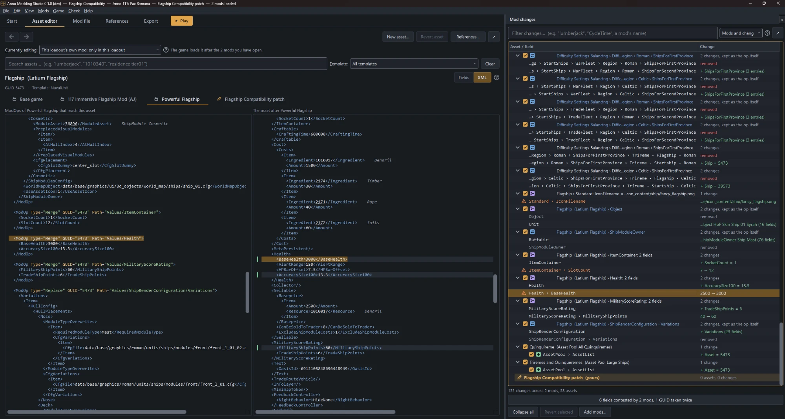
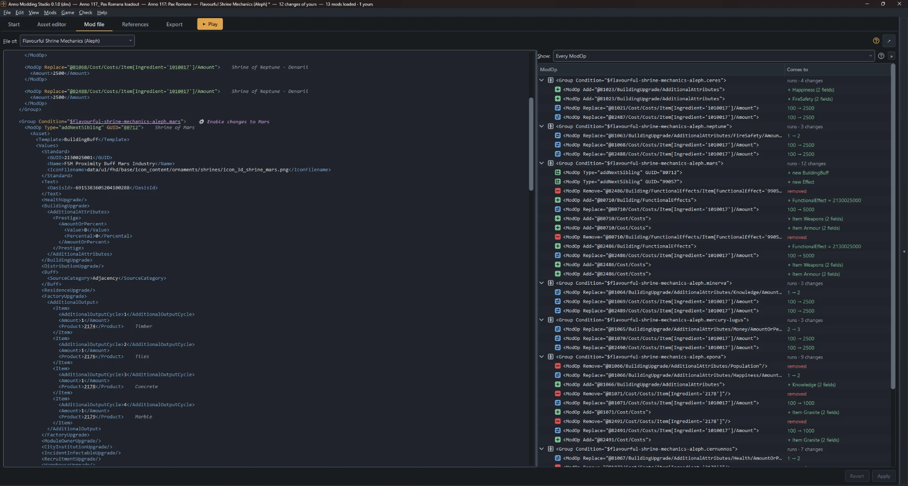

# Anno Modding Studio

A Windows app for Anno 1800 and Anno 117 mods. Key features:
- Open, manage, and run your whole mod list in one stack that shows what each mod
  actually changes, and what happens if they conflict.
- Edit other people's mods to suit your preferences via a targeted "patch" that loads
  after theirs, so updates don't wipe your changes.
- Create mods of your own (and publish to mod.io) via a tree-view fields editor, or an
  XML editor that shows how your ModOps affect assets.

**Status:** public beta, released under the GPLv3 or later. This app is almost entirely
AI-coded; see [AI_DISCLOSURE.md](AI_DISCLOSURE.md) for details.

## Viewing and running your installed mods

 
*The asset editor on a loadout of 13 mods. Each field says which mod set or added it,
and the Mod changes panel lists every change, by mod, option and asset.*

The Studio reads every mods folder the game uses, in load order, and applies each mod
on top of the ones before it. What you see in the editor is, with a few exceptions,
what the game will see when you press Play in the app. Its reading has been run over
every Anno 1800 and Anno 117 mod on mod.io, about 1,200 of them (October 2026).

- **Each mod's in-game changes.** Every loaded mod displays what it actually does in
  your current loadout as a list of discrete changes to specific asset fields, grouped
  by mod and ModOp.
- **Mod collisions.** The Studio's conflict list shows when two mods touch the same
  asset field, when two assets have the same GUID, and when two scripts have the same
  name.
- **Inter-mod references.** A mod that declares another mod as a dependency or as
  something it replaces is noted and can be reviewed.
- **Several sets of mods.** A loadout is the mods you play, in load order, and
  profiles switch some of them on and off. **Play** makes the one you chose what the
  game loads, then starts the game.
- **What the game actually loaded.** After the game starts, the Studio reads its
  modloader log and says whether it loaded what you meant, and which ModOps matched
  nothing.
- **Installing from mod.io** with your own API key: a mod with the mods it needs, or a
  whole collection, with a list of what will download before anything does. Updates
  are checked when you ask, and the old version is kept.
- **A new home for mods, with a way back.** The Studio offers to move installed mods
  out of the game's mod folders into its own library, so that it can easily switch
  what the game sees without cluttering the folder, and so it knows whether or not it
  is managing a given mod. It backs up what it writes over, and can put your mods
  folder back the way it found it.

More in the guide: [Playing a set of mods](docs/guide.md#playing-a-set-of-mods).

## Patching other people's mods to fit your needs

 
*Two flagship mods and a patch to make them fit together. The XML view has a tab for
each mod in load order and one for the patch, and the Mod changes panel marks the
fields both mods change.*

Anything in a mod can be changed, not only the settings its author offers. You can
change a value in the fields editor, type over one of the author's ModOps, switch it
off, or take it out entirely. Their mod itself is never changed: your edits go into a
patch, a small mod of your own that loads right after theirs.

- **Change it where you see it.** Open the asset, change the value, press Play.
- **Keep your changes through its updates.** Install the author's update and your
  patch is still there. If the update changed something you had edited, the Studio
  holds your edit and shows theirs and yours side by side for you to choose.
- **Use the author's options too.** Mods with settings (Anno 117's native "options" or
  iModYourAnno tweaks for 1800) show them with the author's labels. Play writes your
  answers where the game reads them.
- **Share your patch.** Export it as a folder or a zip, or publish it to mod.io, for
  anyone who has the original. The Export tab lists any edit that can't travel with
  it, such as a ModOp of theirs you took out.

More in the guide: [Changing a mod you downloaded](docs/guide.md#changing-a-mod-you-downloaded).

## Creating and publishing your own mods

 
*The Mod file tab. The mod's file as you wrote it, and beside it each ModOp with what
it comes to.*

The Studio reads the game's `.rda` archives itself, for Steam and Ubisoft Connect
installs, so there is nothing to extract. Find an asset by its in-game name, its
internal name or its GUID. The References tab shows what refers to it and what it
refers to.

 
*The References tab, on an effect the mod adds. The assets on the left refer to it, and
it refers to the ones on the right.*

- **Edit in a tree, without XPath.** Change a value, add or remove a list entry or a
  field. The fields offered are the ones the base game uses at that place. Each change
  becomes one narrow ModOp, rather than a widely scoped replace or merge.
- **Or type ModOps.** Type in the ModOps pane of an asset's XML view, or in the mod's
  whole file. What you type is kept and exported as you typed it, notes and blank
  lines included, and shown beside what it comes to. Files your `assets.xml` includes
  are edited as part of one text.
- **Or type into an asset's full XML representation directly.** Change the asset as
  your mod leaves it, or paste a whole asset and change it inline, then click
  **Apply**. The Studio works out the narrow ModOps that make the asset what you
  typed.
- **See what the game works out.** Each ModOp indicates which parts of it are
  evaluated at runtime by the game's mod loader: which assets are targeted by a
  search, which values are set by options or decided based on another asset's value,
  and whether its condition holds.
- **Narrow a wide replace.** A ModOp that claims a whole node can be written as the
  narrow ModOps it comes to today, so it stops overwriting other mods' work.
- **Anno 117 options and scripts.** Editors for the modinfo's Options and Scripts
  blocks, and a way to put part of a mod under an option for players to switch off.
- **Test it.** Play it with nothing else on to see it alone. With the Anno Modding
  Tools extension for VS Code installed, the Export tab also checks it with the game's
  loader, on top of the mods it loads after, and names every field where the two
  disagree.
- **Publish it.** The Export tab checks the mod, writes it as a folder or a zip, and
  sends new versions to its mod.io page once you have made the page.
- **Version history.** Each export and publish is a checkpoint, with a build number
  that moves only when the output changes. You can also create checkpoints manually,
  and can restore to a prior checkpoint's state at any time.

 
*The Export tab, sending a new version to the mod's mod.io page.*

More in the guide: [Writing your own mod](docs/guide.md#writing-your-own-mod) and
[How the Studio reads and writes mods](docs/guide.md#how-the-studio-reads-and-writes-mods).

## Install

You need 64-bit Windows and the game installed.

1. Download `AnnoModdingStudio-<version>-windows-x64.zip` from
   [Releases](https://github.com/aleph-shin/anno-modding-studio/releases).
2. Unzip it into a folder of your own, such as
   `%LOCALAPPDATA%\Programs\AnnoModdingStudio-<version>`.
3. Start `AnnoModdingStudio.exe`. The Studio isn't signed yet, so Windows SmartScreen
   may warn about it: choose **More info**, then **Run anyway**.

To update, unzip the new version into a new folder. Your data carries over. The guide's
[Install and run](docs/guide.md#install-and-run) has the details, and how to run it
from the source with Python.

## What it connects to

No telemetry, crash reporting or analytics. The Studio contacts mod.io only when you
use a mod.io feature, GitHub to check for a newer Studio and to fetch the community
GUID register, and the VS Code Marketplace only if the loader extension is installed.
The guide lists [every request and what it sends](docs/guide.md#what-the-studio-connects-to).

## Known limits

- It doesn't read Lua. A mod that runs scripts is marked, and what its scripts do
  isn't in what the Studio shows.
- Attribute values can't be edited, and the ModOps it writes for your edits have no
  conditions.
- The German translation is made by machine.
- The app should run fine on Linux through Proton 11 or newer, but that hasn't been
  tried yet.

The guide has the [full list](docs/guide.md#known-limits).

## Documents

- [The user guide](docs/guide.md): what to click and what you will see. The Studio
  opens it from *Help › User guide*.
- [Design notes](docs/design-notes.md): why it works the way it does, and what was
  measured.
- [Development](docs/development.md) and [architecture](docs/architecture.md): running
  the tests and working on the code.
- [Standards](docs/standards/README.md) and [proposals](docs/proposals/README.md): the
  rules a change follows, and the plan each larger feature was built from.
- [Credits](docs/credits.md): the projects and people the Studio builds on.
- [SECURITY.md](SECURITY.md): how to report a security problem privately.

## Licence and disclaimers

Copyright (C) 2026 aleph-shin

Anno Modding Studio is free software under the GNU General Public License, version 3
or any later version ([LICENSE](LICENSE)). It comes with no warranty. It contains code
ported from the Anno Mod Loader and iModYourAnno under the MIT licence;
[THIRD-PARTY-NOTICES.md](THIRD-PARTY-NOTICES.md) has the details.

It is a fan-made community tool, not created, endorsed or supported by Ubisoft or by
mod.io. Anno, Anno 1800 and Anno 117: Pax Romana are trademarks of Ubisoft
Entertainment. No game data comes with the Studio: it reads the game files from your
own installation. The guide has the
[full disclaimers](docs/guide.md#licence-and-disclaimers).
