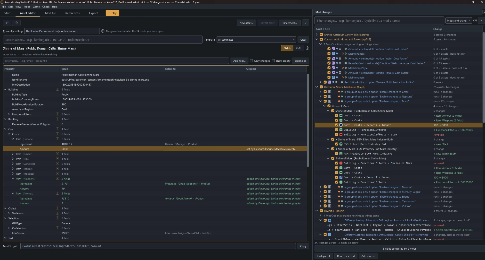
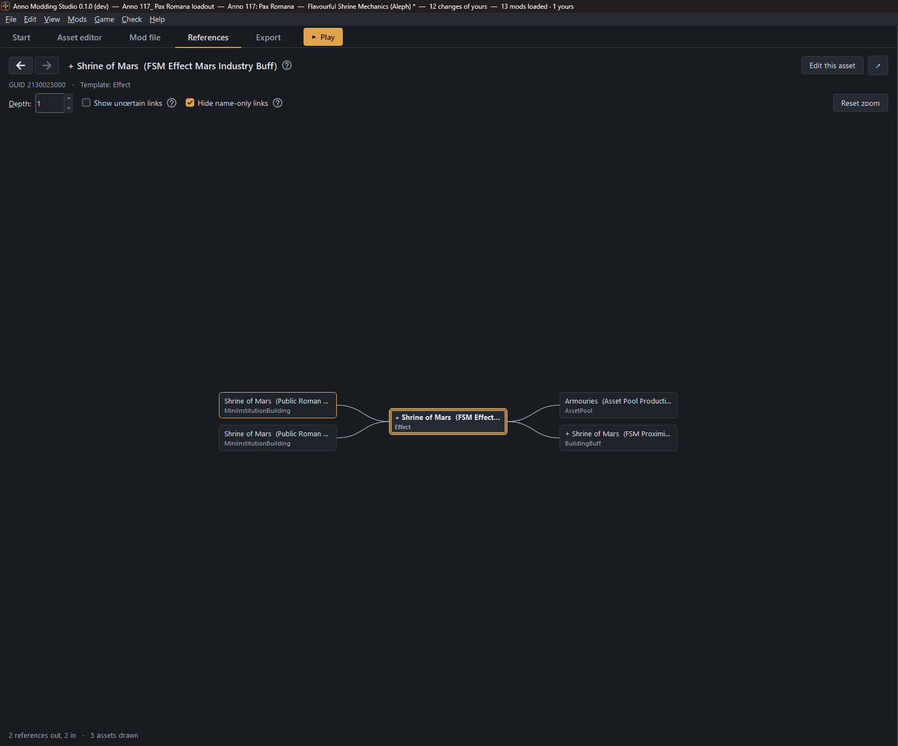
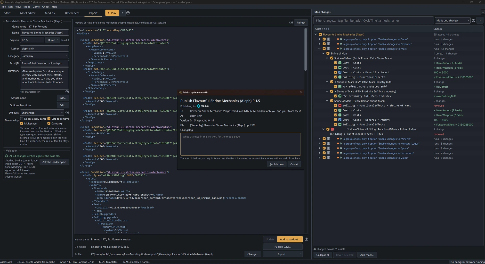

# Anno Modding Studio: user guide

The guide to Anno Modding Studio, a Windows app for Anno 1800 and Anno 117 mods: what
to click, and what you will see. The Studio opens it from **Help › User guide** (F1).
What the Studio is for, and for whom, is in the [README](../README.md).

<br>
*The asset editor. The tree shows the asset as the game will load it, with the mod that
set or added each field, and the Mod changes panel lists what each mod changes.*

<br>
*The References tab. Assets on the left refer to the one in the middle. Assets on the
right are the ones it refers to.*

<br>
*The Export tab. Your mod's details, the XML it will write, the checks on it, and here
a new version on its way to mod.io.*

Other documents:

- [README](../README.md): what the Studio offers, and to whom.
- [docs/design-notes.md](design-notes.md): why the Studio works the way it does,
  and what was measured.
- [docs/development.md](development.md): running the tests and working on the code.
- [docs/architecture.md](architecture.md): how the code is put together.
- [docs/standards/](standards/README.md): the rules for the code, the interface
  and the translations, and the checklist for a PR.
- [docs/proposals/](proposals/README.md): the plan each larger feature was built
  from.
- [docs/credits.md](credits.md): the projects and people the Studio builds on.
- [LICENSE](../LICENSE) and [THIRD-PARTY-NOTICES.md](../THIRD-PARTY-NOTICES.md): the
  Studio's licence, and the licences of what it contains and runs on.
- [SECURITY.md](../SECURITY.md): how to report a security problem privately.
- [AI_DISCLOSURE.md](../AI_DISCLOSURE.md): how much of the Studio was written by AI,
  and how it is checked.

## Contents

1. [Getting started](#getting-started)
2. [The window](#the-window)
3. [Words you'll see](#words-youll-see)
4. [Playing a set of mods](#playing-a-set-of-mods)
5. [Changing a mod you downloaded](#changing-a-mod-you-downloaded)
6. [Writing your own mod](#writing-your-own-mod)
7. [How the Studio reads and writes mods](#how-the-studio-reads-and-writes-mods)
8. [Settings, shortcuts and files](#settings-shortcuts-and-files)
9. [Troubleshooting](#troubleshooting)
10. [What the Studio connects to](#what-the-studio-connects-to)
11. [Licence and disclaimers](#licence-and-disclaimers)

## Getting started

### Install and run

You need 64-bit Windows.

1. Download `AnnoModdingStudio-<version>-windows-x64.zip` from the
   [Releases](https://github.com/aleph-shin/anno-modding-studio/releases) page. The
   `.sha256` file beside it holds the zip's SHA-256 checksum, which
   `Get-FileHash <zip>` in PowerShell shows too.
2. Unzip it into a folder of your own, for example
   `%LOCALAPPDATA%\Programs\AnnoModdingStudio-<version>`. Don't start it from inside
   the zip, and don't unzip it straight into `C:\` or Downloads, where other programs
   or other Windows users can change the files beside it.
3. Start `AnnoModdingStudio.exe`.

The Studio isn't signed yet, so Windows SmartScreen may say *Windows protected your
PC*. Choose **More info**, then **Run anyway**. Or, before you unzip it, open the
zip's **Properties** and tick **Unblock**.

Your loadouts, the library and the settings aren't kept in the program's folder (see
[Files the Studio keeps](#files-the-studio-keeps)), so the folder holds only the
program.

**Updating.** Close the Studio, unzip the new version into a new folder, and start it
from there. It finds your data where the old one left it. Once it works, delete the
old folder. Don't unzip a new version over an old one: files the old one had and the
new one doesn't would stay behind. To go back a version, start the old folder's exe
while you still have it.

**Hearing of a new version.** Once a day, a few seconds after it starts, the Studio
checks GitHub for its newest release. When there is a newer one, a note in the status
bar names it, with a link to its release page and, for the zip, to these steps. The
Studio never downloads or installs anything itself. *Skip this version* on the note
keeps it quiet until a later version is out. *Help › Check for updates* checks at
once. Switch the daily check off under *Settings › General › Updates*. The first time
a new version starts, the note names the version it was updated from, with a link to
the new version's release notes.

**Running from the source.** You need Python 3.10 or newer, installed from
[python.org](https://www.python.org/downloads/windows/), not the Microsoft Store. The
Store's Python runs as a packaged app, and Windows keeps what a packaged app writes
under `%LOCALAPPDATA%` in a private folder of its own, so the library would be one the
game can't see. The same goes for a Studio started from a terminal inside another
packaged app. The Studio checks this as it starts and says so.

```bash
run.bat
```

The first run installs `PySide6-Essentials` and `lxml` if they are missing. You can
also start it directly:

```bash
python -m anno_modding_studio
```

To update, pull the new version with `git pull`. Your data stays where it was, as for
the zip.

To open an extracted assets file at startup, pass its path. The zip's exe takes one
too:

```bash
python -m anno_modding_studio "C:\path\to\assets.xml"
```

### Load the game files

Everything is built against the game's own data. Anno keeps it inside `.rda` archives,
and the Studio reads those archives itself. You don't extract anything by hand.

1. On the **Start** tab, in **1 · Game files**, click **Load from game files…**.
2. The dialog looks for Steam and Ubisoft Connect installs. With one install found, it
   fills in the folder and scans the archives. With several, pick yours from the list
   and the dialog scans it. With none, choose the folder and click **Scan archives**.
3. Pick a language. Asset names then show as they do in game, and you can search by
   them.
4. Click **Extract and load**.

What to expect:

- **The first load takes about a minute.** The Studio builds an index of the file.
  After that it opens at once from a cache.
- **Anno 1800 has 38 archives**, and most hold a full `assets.xml`. The Studio takes
  the newest and shows how many older copies it skipped. Anno 117 keeps everything in
  `config.rda`.
- **The card lists both games.** Each row shows where it stands: in use, read and
  unchanged, read but patched since, or not read yet. **Use these files** opens files
  that were read before without touching the archives. **Read from game files…** on a
  row opens the dialog with that game's install picked and scanned. Loading the other
  game's row is how you switch games.
- **The last game files come back when you start the Studio**, as long as the game
  hasn't changed and the index is built.

If the Studio can't find your install, extract `assets.xml` with
[RDAExplorer](https://github.com/anno-mods/RDAExplorer) and use **Choose a file…**. The
Studio checks the file's contents, so a mod's `assets.xml` is refused as game files.

Switching to the other game's files starts a new loadout, after a confirmation. A
loadout's changes only fit the game they were made against.

### Choose what you're here to do

**2 · What are you here to do?** has three cards. A card sets the loadout up for that
kind of work. It is not a mode: every menu entry stays available, and you can pick
another card later.

| Card | Buttons | What you get |
|---|---|---|
| **Write a mod of your own** | **Start a new mod**, **Open one of yours…** | A loadout that is your mod. The Studio asks for its name. |
| **Change a mod you downloaded** | **Import one mod…** | The mod, read in, and a patch of your own for your changes. |
| **Play a set of mods** | **What I play now…**, **A collection…**, **From the library…** | A loadout: your mods in load order, with their conflicts. |

The other tabs open once game files are loaded and a card is chosen, or once you open
a loadout that already holds work. After a card has something to show, the asset editor
opens.

Choosing a card while mods are loaded asks first, because it clears them the way
*File › New loadout* does.

### Your loadout

**3 · Your loadout** shows the loadout you are in, with **Rename…**, **Open…** and
your recent loadouts. It also shows **Publishing as**: your author name.

- **Set your author name once.** It goes into every mod you export. Mods with this
  author name are yours, and the Studio edits them directly. Other people's mods are
  never changed: your changes to them go into a patch or the loadout's own mod.
  Change it here or in *File › Settings…*.
- **Published under another name before?** Add it to *Also published as* in *File ›
  Settings… › Authoring*. Mods with any of your names are yours. An update to one
  of them keeps the name it has, and new mods get your author name.
- **The loadout file is written on your first change.** Until then the card shows
  *nothing in it yet*. From then on Ctrl+S saves it.
- **Mods read in with no card chosen are a new loadout.** *Game › Match this loadout
  to the mods folder…* before choosing a card gives a loadout with no file yet, called
  *New loadout* on the card and in the title bar. *No loadout* means nothing is
  loaded, changed or chosen.
- **Starting the Studio reloads the game files and leaves the loadout for you to
  choose.**

More about loadouts is in [Loadouts and history](#loadouts-and-history).

## The window

Five tabs, a panel on the right, and a **Play** button after the last tab.

| Part | What it is for |
|---|---|
| **Start** (Ctrl+1) | Game files, what you're here to do, your loadout, and what the game will load. |
| **Asset editor** (Ctrl+2, Ctrl+Shift+2 moves it to a separate window) | Search for an asset and edit it in a tree. |
| **Mod file** (Ctrl+3, Ctrl+Shift+3 moves it to a separate window) | A mod's file, with an outline of its ModOps. The file of the mod your changes go to is typed in; any other is shown. |
| **References** (Ctrl+4, Ctrl+Shift+4 moves it to a separate window) | A graph of what refers to an asset and what it refers to. |
| **Export** (Ctrl+5) | Your mod's details, the XML it will write, validation, export and publishing. |
| **Mod changes** panel (F9 folds it away, Shift+F9 moves it to a separate window) | Every change in the loadout, grouped by mod, then by kept ModOp or asset. Each has a checkbox. |
| **▶ Play** (F5) | Makes the loadout what the game loads, then starts the game. |

The title bar shows the loadout, how many changes are yours, and how many mods are
loaded. `*` means unsaved work and `(new)` means the file isn't written yet.

The Mod changes panel's filter looks in every row, and opens each mod it finds
something in. The box beside it narrows that. **Mod names** looks at the mods' own
rows only, and leaves each mod open or shut as it was. A mod row's right-click
**Filter this mod's changes** hides the other mods, and what you type then looks in
that mod's rows alone. Double-click a change to open its asset at the field. In the
XML view it opens on the tab of the mod the change is under, with the ModOp it comes
of at the top of the ModOps pane.

Where the menus put things:

- **File** holds the loadout (*New loadout*, *Open loadout…*, *Open recent*, *Save
  loadout*, *Fork this loadout…*, *Loadout history…*), then **Game files** (load or
  re-index the game's data and its texts), *Settings…* (Ctrl+,) and *Exit*.
- **Edit** holds *Undo*, *Redo*, *New asset…* and *New rule…*, then whatever the
  selected row in the asset editor offers.
- **View** folds the Mod changes panel away, moves it or the Asset editor, Mod
  file or References tab to a separate window, finds text in the open asset or the
  file (Ctrl+F), searches for an asset (Ctrl+P), and lists the tabs.
- **Mods** holds what is in the loadout: *Add mods…*, *Install a mod from mod.io…*,
  *Mods this loadout uses…*, *Unload mods…*, *Check mod.io for updates…*, and the two
  entries for a collection's mods.
- **Game** holds what the game loads: *Play* (F5), *Make this live…*, *Match this
  loadout to the mods folder…*, *Restore mods from a backup…*, and **Library**
  (converting the mods folder to the library and back, and a folder of your own).
- **Check** holds the questions the Mod changes panel can't answer: conflicts,
  patterns to re-check, ModOps that weren't read, and the check with the game's loader.
  Under them are the loader's own two checks: its reading rules, and whether a newer
  extension is out.
- **Help** holds *Keyboard shortcuts…*, *User guide* (F1) and *About*. *About* shows
  the Studio's version, its licence (GPL v3 or later) and links to the third-party
  notices, the credits and the source. Its **Copy version info** puts the Studio's,
  Python's, Qt's and lxml's versions and the Windows version on the clipboard, for
  a bug report.

With a second monitor, the Mod changes panel and the Asset editor, Mod file and
References tabs can each sit there in a window of its own. *View › Separate window*
moves each (Shift+F9 for Mod changes, Ctrl+Shift+2 for Asset editor, Ctrl+Shift+3
for Mod file, Ctrl+Shift+4 for References), and so does the arrow at the end of its
top row. The same arrow, the same key, or closing the window puts it back.

- The window stays above the main window and is minimised with it.
- Every shortcut works there as it does in the main window.
- The Studio remembers that it was out, and where. If that monitor isn't connected
  at the next start, it opens in the main window.
- A tab stays in the strip while it is out, and says where it is.

With the mod's file in its own window, you see it and the asset editor together:

- The file is drawn again after each change you make in the editor, and the editor
  shows what you apply in the file.
- Ctrl+F finds in whichever of the two has the keyboard.
- Text you have typed and not applied stays where it is when the mod changes under
  it. The line beside **Apply** says the mod changed.

With the asset editor in its own window:

- Anything that opens an asset brings that window forward: a search, a double-click
  on a change, **Edit this asset** in the graph.
- The menus stay in the main window. **Edit** still offers what the row selected
  in the editor offers.
- Undo shows the asset it changed, whichever tab the main window is on.

With the graph and the asset editor in different windows, you see them together:

- The graph moves to each asset you open in the editor.
- Clicking through the graph leaves the editor where it is. **Edit this asset**, a
  double-click or Ctrl+Enter opens an asset there.
- **Pin to this asset** keeps the graph on its asset whatever the editor opens.
- Back and forward in the graph step through the assets the graph has shown, and
  leave the editor's history alone.

A menu that can't do anything yet opens on a greyed line saying why. A submenu that
can't is greyed, with the reason on it, and so is an entry with nothing to act on.
Right-click
works on most rows: search results, tree rows, changes, graph nodes, validation rows.

## Words you'll see

| Word | What it means |
|---|---|
| **ModOp** | One patch operation in a mod's XML. The game applies it when it loads its data. It has a type (replace, add, remove, merge) and a path to what it changes. |
| **patch** | A mod of your own that loads straight after someone else's mod and holds your changes to it. An update to the original leaves the patch in place. |
| **load order** | The order in which the game applies mods. It decides which of two mods the game obeys. It is not the folder order. |
| **ModID** | The identifier in a mod's `modinfo.json`. The game and the Studio identify a mod by it. |
| **mods folder** | A folder the game loads mods from. A game can have more than one. |
| **library** | The folder where the Studio keeps the mods it installs, from mod.io or from a zip you drop on the window. The mods folder holds a link to each one. |
| **generated copy** | A library mod with something of the Studio's written into it: your iModYourAnno settings, or your edits to someone else's mod. Play builds it beside the library and links it in place of the library's copy, which stays as its author shipped it. It is built again whenever that changes, so deleting one loses nothing. |
| **convert** | Puts the mods the game already loads into the library and leaves a link to each in the mods folder. It can be undone. |
| **loadout** | What the Studio opens, and where your work lives: the mods you have open, in load order, your changes, your mod's details if you write one, and the history of its list. Each mod of yours keeps its own history in its project. What it has on is what the game loads when you press Play. A loadout can hold one mod alone: the one you are writing. |
| **profile** | Within a loadout, a named record of which of its mods are on. A loadout has one list of mods and any number of profiles. |
| **collection** | A set of mods somebody curated on mod.io. |
| **pattern** | One edit aimed at every asset that matches a search. It exports as a single ModOp, so it also covers matching assets that other mods add. |
| **kept ModOp** | A ModOp held as it was written, with the changes it comes to today listed under it. Its row is marked for what the game works out as it loads: a pattern (which assets or nodes), a computed value, a condition (whether it runs). |
| **mod file** | The file a mod is exported as: its ModOps, in the order the game runs them. The **Mod file** tab shows one, and takes typing in the one of the mod your changes go to. |
| **author** | Who made a mod: the *Creator* in its `modinfo.json`, and the name you publish under. A mod with one of your author names is yours. |
| **your mod**, **other people's mods** | A mod is yours when the Studio wrote its ModID or its author name is one of yours. The Studio edits your mods directly. Other people's mods are never changed: your changes to them go into a patch, wherever you use the mod, or the loadout's own mod, in that loadout only, and Play writes edits inside their ops into a generated copy. |
| **game files** | The game's own data, read from its `.rda` archives. |
| **Export** | Writes a mod out as a mod folder. Also the tab where you do it. |
| **Play** | Makes the loadout what the game loads, then starts the game. |
| **live** | The live loadout is the one the game loads now. Play, or **Make this live…**, makes a loadout live. |
| **fork** | A copy of a loadout under a new name, to try something in. The original stays as it is. |
| **your own copy** | Someone else's mod made into a mod of yours, in its place, to change directly. Its author's updates no longer reach it. |

Three that are easy to mix up: **Save** stores the loadout. **Export** writes a mod
folder. **Publish** sends a mod to mod.io.

The mod loader's own reference uses "patch" for what any ModOp does to a game file. In
the Studio a patch is always a mod of yours that changes another mod.

## Playing a set of mods

### Loadouts

A loadout is the mods you play, read in load order. Make one from the **Play a set of
mods** card:

- **What I play now…** reads your mods folders in, as the game loads them, into a
  loadout named for the game. If no loadout is live yet, this one becomes the live one.
- **A collection…** opens mod.io's collection search, installs the one you pick, and
  makes a loadout named for it. See [Installing a collection](#installing-a-collection).
- **From the library…** lists the mods in the Studio's library by name, including
  the ones that are switched off. Ticking a mod reads nothing yet, one at a time or
  all at once with the box in the heading (the filter box narrows the list): the
  ticked mods are read together when you press **Read ticked mods**, to see what
  each changes and set its options, or **Read and import**. They come in switched
  on. The ticked mods become a new loadout,
  named for the game. Your mods folder isn't changed until you press Play, which
  switches off every mod the loadout doesn't hold.

*Game › Match this loadout to the mods folder…* reads the folders in again at any
time, with the switches the game has now. It opens on the folder read last time and
reads it when you press **Read mods**. Reading replaces what was read before and keeps
the changes you made yourself.

The list also names the library's mods that have no link in the mods folder, after
the folder's own. They aren't read until you tick one, so a large library doesn't slow
the list down. Ticking one reads it in with the rest, and the ticks you've made are
kept.

To add mods to a loadout that's already open, use *Mods › Add mods…*, or **Add
mods…** at the foot of the Mod changes panel. In a loadout
this opens the same list at once, with the loadout's mods ticked as they were read and
the folder's other mods and the library's listed by name. Nothing is read until you
tick a mod to add. The first tick reads all of them in one go, as the game loads them,
which can take a few minutes for a full folder. Ticks after that read nothing. Each
mod you tick comes in switched on and in its place in load order. The loadout's own
mods keep their switches and their options. Closing the list without importing reads
nothing. In a loadout not started from *Play a set of mods* it opens the one-mod
import, which lists the library's switched-off mods under
a heading of their own. Your mods folder isn't changed until you press Play.

Whichever list it opens, **From mod.io…** and **From a zip…** at its foot get a mod
that isn't on this PC yet: it goes into the library and is added the same way.

Reading shows its progress: the mods being read, the load order, the ModOps turned
into changes, and the checks between mods.

What you get:

- **Each mod keeps its identity.** It has its own group in the Mod changes panel, its
  own checkbox, and its own folder.
- **The mods are read as one stack.** Each mod is read against what the mods before it
  leave behind, the way the game applies them. A condition that asks whether another
  mod is loaded is answered from the stack.
- **The asset editor shows the asset your game will load,** with every mod that is on
  applied.
- **All the game's mods folders are read.** See [Mods folders](#mods-folders).
- **A mod for the other game is left unticked,** with a banner that names the game it
  looks like. Ticking them all leaves it out. Tick it yourself and **Import these anyway**
  lets it through.
- **A mod whose `assets.xml` patch reads as no change is left unticked,** since it
  would come in empty. Ticking them all leaves it out too. Tick it yourself to bring it in.
- **A mod that's switched off in the folder is ticked,** and comes in switched off.
- **The filter box narrows the list.** A hidden mod keeps its tick.
- **The box in the heading of the ticks** ticks every mod shown, or unticks them all
  where they are all ticked. A dash in it means some are ticked. *Unload mods…* has
  the same box.
- **A click on a column heading sorts by it.** The next click turns the order round,
  and the third puts the mods back in load order. Most tables in the Studio sort this
  way. The Mod changes panel and a mod's list of ModOps don't, because their order is
  the order the game applies them in.

A mod with no `assets.xml` patch, such as a texture pack, is listed with no changes.
The game still loads it.

### Profiles

A loadout has one list of mods and any number of profiles. A profile records which of
those mods are on. The mods, their options and your edits exist once, for every
profile.

The picker beside the loadout's name on the loadout card chooses a profile. At its
foot are **New profile…**, **Rename this profile…**, **Delete this profile…** and
**Copy to new loadout…**.

- The chosen profile is what the Mod changes panel's checkboxes switch, what the
  fourth card compares, and what Play makes live.
- A mod that arrives is on in the chosen profile and off in the others.
- You can't delete the profile the game loads until another is live.
- Anno 117's own mod menu shows the profile's name once Play has written it.

**Fork this loadout…** (File menu and loadout card) asks whether you want a new
profile of this loadout or a separate loadout. A separate loadout is a copy under a
new name. The original stays as it was last saved.

### Play

**▶ Play** (F5, or *Game › Play*) makes the loadout what the game loads and
starts the game. One confirmation lists everything it will do. Then, in order:

1. **It stops if the game is running.** Both games read their mods once, at start-up.
   While the game is open, Play is greyed.
2. **It checks** your own mods the way the Export tab does, and checks what the mods
   that will load declare about each other. Findings are listed under *Worth knowing
   first*. They don't stop Play.
3. **It builds** your own mod and your patches into the library and links them into
   the mods folder.
4. **It sets every switch.** Mods the loadout has on are switched on. Mods it has off,
   and installed mods it doesn't mention, are switched off.
5. **It writes the mods' options** where the game reads them. See
   [Mod options](#mod-options).
6. **It records the loadout as the live one and starts the game** through Steam or
   Ubisoft Connect.

Things to know:

- **Opening a loadout writes nothing to the mods folder.** Neither does ticking a
  checkbox in the Mod changes panel. Changes wait for Play.
- **Any loadout can be played.** Your own mod played with nothing else on is that mod
  alone, which is what testing wants.
- **Already live with nothing to write,** Play starts the game without a confirmation.
- **With no loadout,** Play starts the game with the mods folder as it is.
- **Make this live…** (the Game menu, and the fourth card) does everything except
  start the game. Use it if you start the game another way.
- **Starting the game another way.** *Settings › Starting the game* can name a
  program, a shortcut, a launcher or a store address. If neither store is found, Play
  offers to choose one.
- **Anno 117:** Play writes a profile named *Anno Modding Studio* under
  `Documents\Anno 117 - Pax Romana\mods\profiles` and points `profile.txt` at it. Your
  own profiles aren't rewritten.
- **Anno 1800:** Play can't switch mods the game's own mod browser installed. They are
  counted and left alone until you copy them into the library. See
  [The library](#the-library).

### What the game will load

**4 · What the game will load** on the Start tab compares the loadout with the mods
folders on disk.

|                       | Game loads | Game does not load |
|-----------------------|-----------:|-------------------:|
| This loadout has on   |          7 |              **5** |
| This loadout has off  |          **2** |              9 |
| Not in this loadout   |         **58** |              1 |

The three bold cells are the mismatches. Hover a cell to list its mods.

- **Above the grid** is which loadout is live: *Live: Main loadout*, *Live: this
  loadout*, or *Live: nothing the Studio made*. One loadout at most is live, because
  the mods folder holds one set of switches.
- **For a loadout that isn't live,** the mismatches are what Play would change. The
  header shows *Play changes 65* or *Matches*.
- **For the live loadout,** a mismatch means something changed outside the Studio
  since it was made live. The header shows the count and the cells turn orange.
- **A mod you put into the mods folder yourself** has a row under the grid: *1 mod in
  the mods folder is not in this loadout*, with its name while there are three or
  fewer. **Add these mods…** reads it in, on or off as the folder has it. A library mod with no link in the mods
  folder comes in off. The loadout's own mods are read again with it and keep their
  switches.
- **Match the mods folder…**, beside the grid, is for a mod the loadout has off that
  the game loads. It reads the whole folder in again with the game's switches, as
  *Game › Match this loadout to the mods folder…* does. **Make this live…** does the
  reverse.
- **Re-read the mods folder** looks at the folders again. The Studio also does this
  whenever the answer can change: opening a loadout, installing or updating a mod, a
  switch.
- **Check mod.io for updates…** and **Check the whole loadout…** are the Mods and
  Check menus' entries of those names, on the card as well.

**What the game loaded.** Both games' loaders write a log each time the game starts.
For the live loadout, the card reads it and shows the result under the *Live:* line:

> When the game started (24 Sep 23:09), it loaded 41 mods, all of them this loadout's.

Otherwise it names what differs: a mod that didn't load, with what the loader wrote
about it, or a mod that loaded and isn't on in the loadout. For Anno 117 it also names
options the game ran at other values. After Play, the Studio watches for the log for
up to half an hour and shows the result in the status bar.

The card also counts ModOps that matched nothing when the game last started
(*39 ops in 7 mods did nothing*). Each mod's tooltip in the Mod changes panel lists
its own, with the path and the file and line. That is often the first sign that a mod
expects another mod, or that a game update moved what it patches.

If the mods folder changed after Play (another tool switched or installed a mod), the
card shows that and doesn't grade the log.

Anno 1800 lists every folder in the mods folder as a mod, and only runs those with a
`data` folder or a modinfo. The card names the folders that do nothing.

### Switching mods on and off

The checkbox on a mod's row in the Mod changes panel is its switch. Switching a mod
off keeps your changes to it. A mod that is off is struck through, and nothing it does
counts towards the asset you are looking at.

How each game records it, which is what Play writes:

- **Anno 1800** ignores a folder whose name starts with `-`. It also reads
  `mods/activation.json`, which lists ModIDs that are off. The Studio reads both.
  Switching on a mod listed in that file removes its entry.
- **Anno 1800 also loads mods from a `.zip`** in a mods folder. The Studio unpacks
  each zip into its own cache and reads it like a folder. Switching it renames the
  zip. A zipped mod is never exported back out.
- **Anno 117** keeps profiles: `mods/profiles/<name>.txt` lists ModIDs, with `#` in
  front of the ones that are off. `mods/profile.txt` names the live profile.
- **A mod the library holds** is switched by its link. Off means the link is removed
  from the mods folder and the library keeps the folder.

### Load order

Load order decides which of two mods the game obeys. The Studio reads it from the
loader's own log where there is one, and otherwise follows the loader's own sort.

- **Anno 1800** sorts by each mod's folder name.
- **Anno 117** sorts by `[Category] ModName` from each mod's modinfo. The folder name
  doesn't matter.
- **Both** then place every mod that declares mods to load after straight after those
  mods.
- **`*` in a load-after list** puts a mod in a late phase, after every mod without
  one.

A switched-off mod keeps its place in the order.

Where your own mod loads:

- **On a loadout, your own mod loads last.** Its modinfo declares `*`, and names each
  late mod in the list, so the game loads it after all of them.
- **A mod you are writing to publish loads where its name sorts,** because that is
  where it loads for whoever installs it. The Studio places it there among the mods
  you open beside it.
- **A patch loads straight after the mod it patches.** A patch for a late mod declares
  `*` as well.
- **A patch's name must sort after its mod.** For Anno 1800 the Studio refuses a
  folder name that sorts before it. For Anno 117 the Export tab warns when a renamed
  patch sorts before its mod.

### Mods folders

A game loads mods from several folders and merges them into one list. Where a mod
sits doesn't change when it loads. The Studio reads all of them.

- **Anno 1800:** `mods` in the installation, `mods` under Documents, and mod.io's
  download cache.
- **Anno 117:** `mods/.ubi` and `mods` in the installation,
  `Documents\Anno 117 - Pax Romana\mods`, and mod.io's download cache.

A mod from the cache is named under its mod.io id: `3229975/[Building] Nate's Windmill
(Jakob)`.

### Mods inside mods

A mod can carry other mods in its folder. The game loads each of them as a mod, with
its own ModID and its own place in load order. The Studio reads them the same way.

- **A bundled mod's row is under its host's** in the Mod changes panel, with its
  changes. Its second column says where it loads: *bundled, loads at position 3*.
- **A bundled mod switches with its host.** Its row has no box. The game skips a
  host's whole folder, so the host's box switches everything inside it.
- **Your patch to a bundled mod** sits straight below it, under the same host, and
  keeps a box of its own.
- **The game loads one copy per ModID,** the highest version among the copies that
  are on. The Studio reads the same copy. The host of a passed-over copy has a row
  for it, `↪ Shared Pools`, that shows *loads from another mod*. Double-click it to
  go to the copy that loads.
- **Switch off the host whose copy was read** while another host's copy is on, and
  the mod still loads, from the other copy. Its row says so: *(the game loads the
  copy in Other Mod, version 1.1)*. Its rows are still those of the copy read.
  Reading the mods folder again reads the one that loads. Play lists such a mod when
  the versions differ, or when your edits are in the copy that is no longer loading.
- **Someone else's bundled mod is only changed through a patch.** A change written
  into the copy is lost when its host updates. The patch names the mod by its ModID,
  so it follows whichever copy loads.

### Where two mods change the same thing

The game applies every ModOp in load order and keeps the last value. It doesn't warn
you. The Studio does.

- **In the Mod changes panel,** the change that loses is greyed.
- **N fields contested** under the list opens every contested field, one row each,
  with the mod that wins. *Check › Mods reaching for the same
  thing…* opens the same list.
- **Double-click a row** to open the asset. Right-click for the field path.
- **To settle one,** switch off one of the two changes.

Two mods clash when they change the same node, or when one removes a node an earlier
mod edited. Two mods that edit different parts of one asset don't clash.

Some overlaps are meant. A patch overrides the mod it patches. On a loadout, your own
mod overrides the mods in it. A mod that declares it loads after another chose to come
after it. These are listed as intended and left out
of the count.

The same dialog lists two more kinds:

- **Assets sharing a GUID.** The game finds only the first asset with a GUID in the
  file. A mod that creates an asset under a taken GUID is marked on its row
  (*1 GUID taken twice*). The Studio also checks against every other mod on this PC,
  loaded or not. Where the two are in different top-level groups of the file, which
  one the game finds depends on the ops run before: the dialog says so and names
  neither, and an op aimed at that GUID is carried as written.
- **Scripts sharing a name.** Two mods that ship a Lua module with the same file name,
  or set the same global.

A mod's tooltip also lists the game tooltips (InfoTips) it patches, and which other
loaded mods patch the same ones.

### What mods declare about each other

A modinfo can name mods it needs, mods it doesn't work with, and mods it replaces. The
Studio checks these for what Play is about to make live. It shows them on the fourth
card, in Play's confirmation, and in each mod's tooltip.

| A mod declares | The Studio shows |
|---|---|
| It needs a mod that won't load | *A needs B, which is switched off* (or *is not installed*) |
| It doesn't work with a mod that will load | *A does not work with B, and both will load* |
| It replaces a mod that is also on | *B will not load: A replaces it* |

A replaced mod keeps its row and its switch, struck through. Its changes don't count
anywhere. Switching the replacing mod off brings it back.

For Anno 117, a mod's tooltip also shows what its modinfo declares about difficulty
and game setup (needs a new game, safe to remove, multiplayer, campaign).

### Scripts

Mods can run Lua, from an asset or (Anno 117) from the modinfo. The Studio doesn't
read Lua. A script can change anything while the game runs, and the Studio's changes
don't include that.

- A mod that runs scripts shows **(runs scripts)** on its row. Type *scripts* in the
  panel's filter to find them.
- Its tooltip lists what it runs. Right-click › **Open a script** opens a file in
  whatever program you open `.lua` files with. Only `.lua` files inside the mod's own
  folder are listed: a modinfo can name any file, and Windows runs some kinds of file
  when asked to open them. Where `.lua` files open in Lua itself, which would run the
  script, the Studio opens it in the editor Windows has for `.lua`, or shows it in
  Explorer when there is none.
- In the asset editor, a `ScriptFileName` field shows which mod supplies the file.

### The library

Mods the Studio installs live in its library. Your mods folder holds a link (a
directory junction) to each one, under the name the folder would have had. The game
follows the link. Load order isn't affected. Links don't need administrator rights.
A symbolic link to a folder that another tool put in your mods folder counts as a link
too: the mod is the folder it points at.

- **Reading a folder in never moves a mod into the library.**
- **The library's copies stay as their authors shipped them.** Where the game is to
  load a mod with something of the Studio's in it (your iModYourAnno settings, or your
  edits to it), Play builds a **generated copy** of it in the `generated` folder beside the
  library and points the mod's link at that. Text files are copied and anything else
  is a hard link to the library's file, so a copy costs little space. Your edits to
  someone else's mod go in the same way: see
  [Edits inside someone else's ops](#edits-inside-someone-elses-ops). Each copy holds
  a `generated.json` saying what it was made from, and is checked against it every
  time it is built. With nothing of the Studio's left to write, the link goes back to
  the library's copy and the generated one is deleted.
- **You can leave.** *Game › Library › Put the library's mods back into the mods folder…*
  turns every link back into a real folder. A mod with a generated copy goes back as
  that copy, the mod the game was loading. Do this before you delete the library.
- **Where it is:** under your local app data. *Settings › Library* moves it. The
  game's own drive is a good choice.
- **What it couldn't get back.** *Settings › Library* counts the mods the library holds
  the only copy of: a folder moved in from your mods folder, with nothing on mod.io
  matched to it. **List them…** shows them. Mods that came into the library before the
  Studio recorded where a mod came from are listed apart, under *Not recorded*. A check
  for updates that finds a mod on mod.io takes it off the list.
- **Backing them up.** A zip you drop on the window is kept as it is in
  `Documents\AnnoModdingStudio\backups\library\`, so its mod is never an only copy.
  In the list, **Back up** zips the chosen mods whole into the same folder; the only
  copies start chosen. To get a mod back, drop its zip on the Studio's window.

**Converting your mods folder.** The mods the game already loads can go into the
library too, so the Studio can switch each one. Under the grid, the fourth card
shows how many are outside the library, and names them while there are three or
fewer, with **Convert to library…** beside the count. *Game › Library › Convert the mods folder to the library…* does the same. The
fourth card's header shows the count while the loadout matches what the game loads.

When **What I play now…** reads in mods that are outside the library, the Studio
offers the conversion. **Not now** leaves everything where it is.

Under that row, the card lists what is left, one place to a row. Each row has a
count and one button, and disappears at zero:

| Row | Button |
|---|---|
| Installed by the game's mod browser | **Copy to library…** |
| In your folders | **Move to library…** |
| Copies the game's mod browser still keeps | **Unsubscribe in game…** |

The first two rows convert one place's mods. They appear when both places hold
mods.

**Convert to library…**, **Copy to library…** and **Move to library…** open a
survey first:

- **One row per mod,** grouped by where the copy the game loads lives, with what will
  happen to it and to its other copies.
- **The copy the game loads goes into the library.** Other copies are set aside in the
  backups. They aren't deleted.
- **Untick a mod** to leave it where it is. A folder with `.git` in it is left alone.
- **Profiles from other tools** (iModYourAnno's, Anno 117's own) become profiles of
  the loadout. One the loadout already has by name is listed unticked.
- **Keep a full copy** zips the folders first. It is ticked the first time.
- **The game must be closed,** and the open loadout must match what the game loads
  now. The Studio offers to read the folder in first.

Afterwards the report shows whether the game loads the same mods as before.

**Undo.** *Game › Library › Undo the conversion to the library* puts every folder back
where it was, with its old name, and restores the files Play may have rewritten.

**Unsubscribe in game…** lists the copies the game's mod browser still keeps of mods
the library holds, with what to do for each. You unsubscribe in the game. A
subscription belongs to your account, so unsubscribing removes the mod from the game's
browser on every PC. If another mod.io account holds a copy, the list offers **Start
the mod browser's folder afresh…**, which moves the game's mod.io folder into the
backups so the game rebuilds it. This applies to Anno 1800 only. Anno 117 has no
in-game browser.

**A mod you develop elsewhere.** *Game › Library › Manage a folder of your own in the
mods folder…* links a folder in where it is, without copying it.

**A mod you have as a zip.** Drag the zip onto the Studio's window. While the zip is
over it, the window is framed and shows "Drop to install in the library". The Studio lists
the mods it holds and shows the mods folder they will be linked in, before anything
is unpacked.

A zip goes into the library of the game whose files are loaded. When a mod in it has
the folder layout of the other game, the Studio asks first. Nothing is installed
unless you choose **Install anyway**. To install it for its own game, load that
game's files on the Start tab and drop the zip again.

- **Add to loadout** installs them into the library and reads them in. With a loadout
  read from a mods folder open, the folder is read again. Otherwise each mod is imported on its own.
- **Open as loadout** is offered for a zip of one mod. It starts a new loadout for
  that mod. A mod with your author name is opened as yours. Any other mod gets a
  patch. With no loadout open and nothing chosen on the Start tab, it is the only
  choice for one mod.
- A copy the library already has with the same ModID is replaced, and the old copy is
  set aside in the backups. It keeps its folder name, so its place in the load order
  doesn't move.
- The zip goes into the library of the game whose files are loaded. With no game
  files loaded, the Studio shows that and installs nothing.

### mod.io

The Studio contacts mod.io only when you click something that does.

**Your key.** The mod.io tab of *Settings* takes your API key from
[mod.io/me/access](https://mod.io/me/access). A key only reads. It is encrypted for
your Windows account and kept in the Studio's local app data. It is never written to a
loadout, an export or a log. **Forget key** deletes it.

**Signing in** is needed only to publish. Enter your mod.io email, then the code
mod.io sends. mod.io's terms are shown first. You never type a password. Wherever
the Studio needs an account you haven't set up, **Set up mod.io account…** opens
Settings on that tab.

A sign-in lasts a year, and mod.io offers no way to renew it except signing in again.
For the last two weeks, Settings and the Export tab's **On mod.io** row say when it
runs out. Once it has run out it is no longer sent. If mod.io stops accepting it earlier,
for example because you signed out on its website, the Studio removes it when a
publish is refused and asks you to sign in again. Nothing is sent in that case.

#### Installing a mod

*Mods › Install a mod from mod.io…*, or **From mod.io…** in *Add mods…*, is a search box. Type a name, or paste the
mod's page address from your browser. Pick a result and click **Install mod**.

- The file is checked against mod.io's checksum and installed into the library, with a
  link in the mods folder. The dialog shows both places. **Change…** picks another
  mods folder.
- With a loadout open, the folder is read again. Otherwise the mod is imported on its
  own.
- If the mod needs other mods, they are listed first. **Install them too** installs
  the missing ones.
- A file mod.io's scan flagged isn't downloaded.
- If mod.io gives no checksum for a file, the file is installed anyway, and the
  Studio says that the download couldn't be checked. This goes for collections and
  updates too.

#### Installing a collection

The same dialog has a **Mods / Collections** switch. Pasting a collection's address
sets it for you. **See what it installs…** opens a plan before anything downloads:

- A row for every mod, showing whether you have it already.
- The download size and the space it needs.
- Mods you don't have are ticked. Mods you have are left alone. A mod with a newer
  file on mod.io has a box you can tick.
- A collection lists mods, not versions. You get each mod's current file.
- One failed download doesn't stop the rest. **Stop** keeps what arrived, and the
  plan offers what is missing next time.

If a loadout is live, the Studio asks what to start from: the collection on its own,
a new profile of the live loadout, or a separate copy of it.

Mods remember the collection they came with. The **From** column shows it.
*Mods › Switch off a collection's mods…* switches off what a collection
brought, in the chosen profile. *Take a collection out…* removes those mods from the
loadout and offers to delete library copies no other loadout uses.

The Studio doesn't subscribe your account to anything.

#### Checking for updates

*Mods › Check mod.io for updates…* lists the loaded mods, ticked, and asks
mod.io nothing until you press **Check**. The Start tab's fourth card has the same
button, and a mod's row in the Mod changes panel has **Check for an update…** on its
right-click menu, which lists that mod alone. Untick the ones you don't want checked, or
filter the list and use the box over the ticks. **Check** then asks about the ticked
mods, one row at a time: each row shows the current version on mod.io and how the
match was made (**Matched by**) as soon as its answer is in. **Stop** ends the check and
keeps what was answered.

A match by name alone is the least certain. A mod installed from a zip you downloaded
from mod.io is matched by the zip's hash where it can be, which is certain.

**Download and update** replaces each ticked mod that has an update with its current
file. It asks first when there is more than one. A ticked mod that can't be updated
from here is counted under the list; choose its row to see why.

- The old folder is moved whole to `Documents\AnnoModdingStudio\backups\replaced\`.
- A library mod's old version is also kept as text (its ModOps, modinfo and other text
  files) in the `previous` folder beside the library, one version back.
- The new copy keeps the old folder's name and its switch.
- iModYourAnno settings are carried into a generated copy of the new version. The
  library's copy is the author's.
- A copy the game's own browser installed is updated by that browser. A bundled mod
  is updated with its host.

#### A loadout built on mods you don't have

A loadout records the mods it was built on. If some aren't installed when you open
it, the Studio shows the count and offers **See what installing them takes…** or **Open
it as it is**. The loadout opens fully either way. *Mods › Mods this loadout
uses…* opens the same plan later.

### Unloading mods

*Mods › Unload mods…* removes loaded mods from the loadout. It doesn't touch
their folders. If you changed a mod, the confirmation names those changes, because
unloading discards them. A mod you changed through its patch is asked about too: the
patch stays, with your changes in it, greyed and left out of exports and Play until
the mod is loaded again.

### Backups

Before the Studio writes over a mod's files, it copies them.
*Game › Restore mods from a backup…* puts a copy back.

- The copies are in `Documents\AnnoModdingStudio\backups\`, one dated folder per
  export or Play.
- A copy holds the files the Studio can overwrite: the ModOp patches and the files
  they include, the modinfo, the texts files, the Lua scripts, and Anno 117's profile
  and options files. The rest of a mod is copied in from the mod itself, which still
  has it.
- Before **Replace**, the export names the files it writes over.
- Twenty are kept. The first copy of every file is kept for good.
- Restoring writes those files and nothing else. It removes a file the export
  created.

Why these work the way they do: [loading every mod you have](design-notes.md#loading-every-mod-you-have),
[load order](design-notes.md#read-as-one-stack-not-one-mod-at-a-time),
[conflicts](design-notes.md#where-two-mods-reach-for-the-same-thing),
[mods the game is not loading](design-notes.md#mods-the-game-is-not-loading) and
[mod.io](design-notes.md#modio) in the design notes.

## Changing a mod you downloaded

The short version: click **Import one mod…** on the Start tab, pick the mod, change
what you like in the asset editor, and press Play. Your changes go into a patch.

### Importing a mod

**Import one mod…**, or *Mods › Add mods…* in a loadout not started from *Play a set of mods*, opens on
your mods folder and lists the mods in it. Pick one, or **Browse…** to a mod elsewhere, then
**Read mod**.

The **ModOps** tab has a row for every op and group in the mod, with the badge and
marks the [Mod changes panel](#modops-kept-as-written) draws, and what became of
reading it:

| Outcome | Meaning |
|---|---|
| **Read** | The Studio knows what the op changes today. **Comes to** says how much. |
| **No change today** | Your game files already read that way, or the op's condition doesn't hold. |
| **Runs today**, **Does not run today** | For a group: whether what is in it runs. |
| **Needs a look** | The Studio couldn't read it. The row shows why. |

Every op the Studio read is ticked, the ones that change nothing today too: they are
as much the mod's as the others. A ticked op comes in as it was written. Untick any
you don't want.

- **An op in a group** is set in under it. Ticking it ticks its groups, since its
  condition is theirs, and unticking a group unticks everything in it.
- **An op that needs a look** has no tick. It goes with the mod and is exported as
  written. What it does isn't shown.
- **Importing the same mod again** updates what it brought before. An op that says
  what it said is the op already there.

The **Not ModOps** tab lists everything else the mod ships: text patches, models,
bundled mods, and other patched files.

The options under the list each have a `?` that explains them:

- **Keep inert removals.** See [Removals that change nothing](#removals-that-change-nothing).
- **Mod options…** sets the mod's own settings before it is read. See
  [Mod options](#mod-options).
- **Keep it separate** loads the mod beside yours as its own mod. Unticked, its
  changes are folded into the mod you are writing.
- **This is my mod** (only when folding in) takes the mod's name, ModID and version
  too, so your next export is an update to it. It is ticked for you when the mod's
  author name is yours.

Importing the same mod twice updates what the first import put there.

### Patches

A patch is a mod of your own that loads straight after someone else's mod and holds
your changes to it. When the author releases an update, you install it and your patch
is still there.

- **Someone else's mod is never changed.** What you want different about it goes into a
  mod of yours: your patch for it, which holds wherever you use their mod, or the
  loadout's own mod, which holds in that loadout only. See
  [Edits inside someone else's ops](#edits-inside-someone-elses-ops).
- **A patch is made when you need one.** Importing through **Change a mod you
  downloaded** makes it. **Currently editing** lists *A new patch for …* for each mod
  of someone else's that has none, and picking it makes one. **Patch this mod…**, on
  the mod's right-click menu in the Mod changes panel, makes one and asks what to call
  it.
- **It loads after the original** because its modinfo declares that by ModID. It is
  named after the original with ` (my patch)` added.
- **In the Mod changes panel** it is drawn under the mod it patches:
  `↳ your patch for [Gameplay] Roomier Farmers`.
- **A new patch starts empty.** What the loadout's own mod keeps of that mod stays
  there, in this loadout only.
- **If the patched mod is switched off or unloaded,** the patch is greyed and left
  out of exports and Play.
- **A patch can need more than one mod.** A change that is only fair while two mods are
  on, such as a buff that makes up for two nerfs, belongs to both. Right-click the
  patch and choose **Needs another mod too…** to pick another loaded mod. The patch
  then loads after every mod it needs and is left out while any of them is off. Its
  row names them all, and each one's row says `(also patched by …)`. **No longer
  needs …** takes one away. Its modinfo lists them all to load after and as
  dependencies, so the game's loader says so when one is missing.
- **Your own mods get no patch.** The Studio edits them directly.
- **Someone else's bundled mod is always changed through a patch.**

### Your own copy of someone else's mod

To change someone else's mod directly, make it yours: **Make your own copy…** on its
right-click menu in the Mod changes panel, or **Make my own copy…** when the Studio
asks which mod of yours keeps a change to it. Before anything happens, the Studio
says what that means:

- It is your copy now. Its author's updates no longer reach it.
- You should not share it without its author's permission.
- The library's copy, as its author shipped it, is kept.
- *Anno 1800 only:* mods that need the original will say it is missing. Anno 1800's
  loader doesn't count your copy as the original.

Where the mod names an author, the question also offers **Carry on as mine**, for a
mod you published under another name. There is no copy then: the author name becomes
one of yours, and the mod keeps its name, ModID and author name. It is kept in a
project, and with *Fold my patch in* ticked your patch goes into it. Where the
loadout holds only that mod and its patches, the loadout carries on with it, as it
would with a mod with your author name, and the Export tab publishes it.

Then:

- **Your copy is a mod of yours** with you as its author and a ModID of its own, kept
  in a project. Its files are a copy of the original's beside the library, hard links
  where they can be, so it costs little space. Changes go straight into it.
- **It takes the original's place** in the loadout, in load order, with the
  original's settings. Anno 117 keeps settings by ModID, and your copy's are written
  under its own.
- **Its modinfo replaces the original.** `DeprecateIds` (Anno 1800) or
  `Dependencies.Deprecate` (Anno 117) lists the original's ModID, so the game leaves
  the original out wherever your copy loads. In Anno 117 a mod that needs the original
  counts as needing your copy.
- **Your patch for the original** patches nothing once the original is left out, so
  the Studio offers to fold it in: its changes, and its edits inside the original's
  ops, become your copy's, and the patch leaves this loadout. Its project is kept for
  the other loadouts that use it, which the question names. Not folded, the patch
  stays, greyed, patching nothing.
- **Your edits inside the original's ops** become your copy's own.
- **A bundled mod, or a mod with others bundled inside it,** can't be copied this way.

### Edits inside someone else's ops

You can change one of someone else's ModOps where it stands: type over it in its
file, switch it off with its checkbox in the Mod changes panel, take it out, **Edit
this pattern…**, or **Write as narrow ModOps…**. Their mod is still not changed: the
edit is kept by a mod of yours, and the library's copy stays as its author shipped it.

- **The Studio asks which mod of yours keeps it,** unless that is known already. Your
  changes go to your patch for that mod, or the loadout's own mod keeps edits to it
  already. The question offers your patch for it (made if there is none yet), which
  holds wherever you use the mod, this loadout's own mod, which holds here only, or
  [your own copy of it](#your-own-copy-of-someone-elses-mod). Your answer is where
  changes go from then on. A bundled mod's edits go to its patch without asking.
- **A pattern of theirs is written again in the mod of yours you choose,** as a new
  pattern after theirs. *Edit this file* on their file goes to that mod's file.
- **The keeper's project keeps the edits.** Your patch brings its edits into every
  loadout that uses it. The loadout's own mod's edits stay in that loadout.
- **Play writes them into a [generated copy](#the-library).** Each op of theirs you
  changed, took out or switched off gets `Skip="1"`, which switches it off where it
  stands, and yours goes straight after it with a comment saying it is the Studio's.
  Where your patch and the loadout's own mod both keep edits to one mod, the patch's
  come first and then the own mod's, as the two mods load. Everything else in their
  files is byte for byte theirs.
- **An update keeps them** where the op you edited is still there, moved or not. The
  new version is read in, and the next Play writes your edits into a copy of it.
- **An update that changed or took away an op you edited holds your edit.** It isn't
  applied, so the game gets their new version, and nothing is dropped. The Studio
  shows their op as you edited it, as it is in the new version, and yours, side by
  side. **Use mine on the new version** puts your edit on their new op; **Keep theirs,
  drop mine** lets it go. **Decide later** leaves it held: the mod's row says so, and
  its right-click menu has **Review edits held after an update…**. Play lists held
  edits under *Worth knowing first*. A held edit stays with the mod of yours that
  kept it.
- **An op of theirs you switched off stays off** when the mod is read again.
- **The mod's row** in the Mod changes panel counts your edits, and its patch's row
  says how many of them the patch keeps.
- **Exporting its patch to share** (a folder, a zip, an update on mod.io, or **Copy
  XML**) carries each edit the patch keeps that can be an op of the patch's own. The
  loadout's own mod's edits are no part of it. They go at the top of the patch, so they
  run after their mod:
  - a value you typed over, where your op is a `replace` or a `merge` aimed where
    theirs was and setting all theirs did,
  - a value inside an asset their op adds, as a `merge` on that asset by its GUID,
  - a value inside a list entry, as a `merge` on the entry found by what it holds,
    such as `Item[Product='1010200']`,
  - an op of yours you put among theirs.

  Where iModYourAnno's knobs set values in their op, only the values you changed go,
  so the knobs keep working for whoever gets your patch.

  In Anno 117, an op that reads one of their mod's settings goes with the setting
  named in full: `$their-mod.hard` for `$hard`. A bare name in your patch would be
  your patch's own setting. In Anno 1800, and for a mod with no ModID, such an op is
  left out.

  The rest can't travel, because whoever gets your patch has their mod as its author
  shipped it. That's an op you took out or switched off, a list entry nothing tells
  from the next, a value worked out, a condition that reads the game's files, an op a
  later op of theirs changes again, an op or group a tweak tool switches on and off,
  or a value a tweak tool sets. The Export tab's preview of the patch lists each one
  left out with why, and the export says how many. The tab's check with the game's
  loader tests the patch as it's exported, on top of their mod as shipped. Play still
  writes your edits into the generated copy, and the patch without them.
- **Play needs the game files loaded** to work your edits out. Without them the mod
  loads as the library has it, and Play says so.
- **A mod in a folder of your own** is still written where it is when you play, as
  before.

### Which mod an edit goes to

**Currently editing**, above the asset tree, shows which mod of yours your edits land
in and lets you choose. Each choice says how far it reaches: *Your patch for Their
Mod: wherever you use it*, and *This loadout's own mod: only in this loadout*.
Someone else's mod is not one of the choices; *A new patch for …* makes a patch for
it. The Mod changes panel draws that mod's row bold, with a pencil and a band of the
accent behind it, and marks your own mod `(yours)`. Where that mod is not the
loadout's own, its row also says `← editing this mod`.

When you edit one of the loaded mods itself:

- **The editor shows the asset as that mod leaves it,** without the mods that load
  after it.
- **A field an earlier mod set** shows `set by <mod>`.
- **A field another mod added and this one sets** shows `set by this mod`. Its menu
  has **Stop setting this**, which takes this mod's value back and leaves the field.
- **A field a later mod overwrites** shows `overwritten by <mod>`. That includes your
  own mod.
- **Pointing at one of your mods** shows how many mods load after it and how many
  of its ModOps weren't read.
- **A mod you are writing to publish** sits where its name sorts. The caption under
  **Currently editing** counts the mods that load after it and can overwrite your values.

Edits you make to a mod that was read from disk are written after that mod's own ops.

### Mod options

Some mods have settings their author built in. **Mod options…** shows them with the
author's labels and ranges. It is in the import dialogs and on a loaded mod's
right-click menu in the Mod changes panel.

- **Changing an option reads the mod again,** so the changes show what the setting
  does. Changes of your own that were folded into that mod don't survive this, and the
  dialog warns you first. The mods that load before it are read as you have edited
  them here.
- **Play writes your answers where the game reads them.**
- **Anno 117:** options are declared in the mod's `modinfo.json`. The answers are in
  `Documents\Anno 117 - Pax Romana\mods\active-options.jsonc`. The Studio starts from
  what that file holds. A ModOp reads its own mod's option as `$range`, and any
  loaded mod's as `$mod-id.range`. The Studio reads both.
- **Anno 1800:** the options are iModYourAnno's tweaks. The Studio reads them from the
  mod's folder as the game runs it. Each switch is also a row under the mod in the
  Mod changes panel. For a library mod, Play writes them into a
  [generated copy](#the-library) and never into the library's copy.
- **An update keeps your answers.** An option the new version dropped is named.

Where the author offers an option, use it. It survives the mod's updates. A patch is
for what the author didn't offer.

### When the original updates

1. *Mods › Check mod.io for updates…*, select the mod, **Download and update**.
2. The folder is read again. Your patch stays where it is.
3. Check the **Validation** list on the Export tab, or press Play. A change in your
   patch that no longer applies is listed. Double-click it to open it.

### How the Studio knows a mod is yours

By ModID first, then by author name. The Studio writes its own ModID into mods it
exports. A mod you wrote before using the Studio is recognised by its author name
matching **Publishing as**, or one of the names in *Also published as*. With no author
name set, no mod counts as yours.

- **A mod of yours is kept in a project.** The Studio changes it directly only once a
  project keeps it.
- **A mod with your name on it that no project keeps** is one you wrote before the
  Studio, or one whose project is gone. It is read like anybody else's mod until you
  make a project for it. **Open one of yours…** says that nothing keeps it and offers
  to make one. So does **Currently editing**, where it is listed as *Make … a project
  of yours…*, the mod's right-click menu in the Mod changes panel (**Make a project of
  yours…**), and **Edit this file** on its file. Where a project already keeps its
  ModID, that project is used.

Why: [importing someone else's mod](design-notes.md#importing-someone-elses-mod) and
[your own mod is one of them](design-notes.md#your-own-mod-is-one-of-them) in the design notes.

## Writing your own mod

Click **Start a new mod** on the Start tab and name it. To carry on with a mod you
already have, click **Open one of yours…**. It stays the mod it is: it keeps its
ModID and is exported under its own folder name until you rename it.

### Finding an asset

Search is at the top of the asset editor. Type an in-game name, an internal name
(`residence_tier01`), a GUID or a template. The results drop down over the tree.

- **Esc** closes the list. **Ctrl+P** opens it again. So does Ctrl+F while no asset
  is open.
- The **Template** box narrows the results.
- A GUID always finds its asset, whatever the filters.
- The list shows the 400 best matches and the total.
- **Right-click a result** for **Open in asset editor**, **References for this
  asset…**, **Copy GUID**, **Copy internal name** and **Show only &lt;template&gt;**.
- **Back** and **Forward** (Alt+Left, Alt+Right, or the mouse's side buttons) walk
  the assets you have visited. The References tab shares the same history.

### Editing

The asset is a tree of its current values. Double-click a value, or press Enter, to
edit it.

- **Original** shows the value before your change. Changed rows are highlighted.
- **Typing the original value back** removes the change.
- **Refers to** shows the asset a GUID field points at. Double-click it, or
  right-click › *Choose asset…*, to pick another.
- **Filter fields…** searches within the asset, and Ctrl+F puts the keyboard there.
  **Only changed** shows what the mod touches. **Show empty** shows empty fields and
  list padding. **Expand all** opens every row, and then reads **Collapse all**.
- **ModOp path** shows the path the selected value will be targeted by. **Copy**
  copies it.
- **The asset's own GUID is read-only.** Other GUID fields are editable.
- **Revert asset** drops every change to the asset.
- **Right-click a row** to copy its path or value, revert it, or remove it.
  **Show in XML view** goes to the field in the XML view, and to the ModOp that
  writes it.

**Adding and removing.**

- **A `+`** at the right of a row adds to it: another entry on a list, or a field on
  anything else. Right-click offers the same.
- **Add field…** adds a top-level section the asset doesn't have.
- **Right-click › Remove from asset** removes a node.
- Additions are shown in green italic. Removals are struck through. You can edit and
  add under something you added.
- The fields offered are the ones the base game uses at that place. **Used by** shows
  how many assets use each one.
- A list entry shows which entry it is, such as `Item (Marble)`.

The tree shows the asset as it will be: the game's asset with every loaded mod and
your own changes applied. Changing something you added updates that one ModOp.

A list entry is addressed by its content where possible
(`Item[Product='1010365']`). An entry with nothing unique in it is addressed by
position (`Tag[2]`). Those rows are flagged, because a game update that reorders the
list would move the target.

**Undo.** *Edit › Undo* (Ctrl+Z) and *Redo* (Ctrl+Y) cover everything that changes
what the mod writes: edits, additions, new assets, patterns, checkboxes in the Mod
changes panel, and mods switched off or unloaded. The menu names the next undo. A
step puts back the mod it was made in and leaves every other mod as it is now.
Reading mods in, making a patch, restoring a checkpoint and opening a loadout clear
the undo history.

### The asset as XML

**Fields** and **XML**, the two halves of the switch beside the asset's name, change
how the asset is shown. Both show the same asset, with the same mod your changes go
to. The Studio remembers which you used last.

XML shows a row of tabs in load order: **Base game**, then each loaded mod that
changes the asset. The mod your changes go to always has a tab, and opens first.
Opened from a row of the Mod changes panel, the asset opens on the tab of the mod the
row is under instead.

- **Base game** shows the asset as the game files have it.
- **A mod's tab** has two panes. The left one shows the ModOps the mod writes for
  this asset, as the Studio writes them. The right one shows the asset once that mod
  has run. So the right pane of one tab is what the left pane of the next is applied
  to.
- **A bar beside a line of the asset** marks a line that mod changed, and the line
  is shaded. Open a tab and the asset scrolls to the first one if none is in view.
- **Click an op** in the left pane and the right pane goes to the field it sets.
- **The last tab's asset** is what the game loads, and its heading says so.
- **A pencil** marks the tab of the mod your changes go to. **A lock** marks the
  others, which are read-only.
- **A warning sign** marks the tab of a mod that loads after yours and writes over a
  field yours sets. The line under the panes names the fields, and the same sign is
  beside each in the asset.
- **Two arrows at the end of the row** scroll it when more mods change the asset than
  fit. Each tab's tooltip has the mod's name.
- **A ModOp that reaches other assets too** is in the pane with the asset's own, in
  the order of the mod's file: a pattern, one that names several assets, one in a
  group. On the tab you type in it is on a tinted band under a heading that says how
  far it reaches. See *Typing ModOps* below.
- **Ctrl+F** finds text in the pane you are in. Enter or F3 goes to the next match,
  Shift+F3 to the one before, and Esc closes the bar.
- **Right-click a line of the asset** for **Show in Fields view**, which selects that
  field in the tree.

The asset shown is the Studio's reading. Where a mod has a ModOp the Studio could not
read, or the game's loader left the asset different when you checked the mod on the
Export tab, the tab says so.

**Typing ModOps.** On the tab of the mod your changes go to, the ModOps pane is a
text box. Type ModOps for the asset, or change the ones there, then click **Apply**
(Ctrl+Enter).

- **Apply keeps each ModOp as you typed it,** and reads it the way the Studio reads a
  mod you downloaded, to show what it comes to. The line beside the button says how
  many ModOps in the pane are new or changed, and how many were taken out. One Apply
  is one step of *Undo*.
- **Undoing an Apply puts what you typed back in the pane,** as text typed and not
  applied, so you can put it right and apply it again. *Undo* goes to the asset it
  was typed on first, if another is open. The text comes back only in the XML view,
  on the tab of the mod it was typed for. Anywhere else the Apply is undone and the
  pane shows the mod; *Redo* has it back. The text is dropped again if you step
  further back or redo without typing in it.
- **What you typed is the whole of it.** An op you take out of the text is taken out
  of the mod. An empty pane means the mod leaves the asset alone.
- **A ModOp on a tinted band reaches other assets too.** The heading drawn above it
  says how: *Pattern · Reaches this asset and 40 others*, or *In a group that does
  not run today · Condition #SomeMod*. The heading is not part of the text. Click it,
  or right-click it, for **Show in file** and for the other assets it reaches.
  - Left as it is, the op is left as it is, for every asset.
  - Typed over, it changes for every asset it reaches, and keeps its place and its
    group.
  - Taken out of the text, it is taken out of the mod, for every asset.
  - A group's own tags are not in the pane, since a group holds ModOps that do not
    reach this asset. Type over a group on the **Mod file** tab.
- **The button says how far Apply reaches** when that is further than this asset:
  *Apply to 41 assets*. For a pattern you typed or changed it says *Apply to a
  search*, since how many assets a search finds is not known until it is read. Apply
  then reads it and asks, with the number, before anything changes.
- **Nothing is rewritten.** A merge of two fields stays one merge, and a path stays as
  you wrote it. After Apply the pane shows each op as it is exported.
- **Only what you changed moves.** An op you left alone keeps its place in the mod's
  file, its note and its switch, and is not read again: what it comes to stays as it
  was read with its mod. An op you typed over takes the place of the one it was typed
  over.
- **A new op goes where you typed it, among the ops in the pane.** In the mod's file
  it lands straight after the op you typed it after, or straight before the first op
  if you typed it at the top. The pane holds only the ops that reach this asset, so
  ops of the file that are not in it may come between your new op and the next one
  you see. After an op in a group, the new op goes after the whole group, unless the
  next op in the pane is in that group too: then it goes between them, outside the
  group, and the group is written in two parts round it. In an empty pane it goes
  after the mod's other ops. To put it at an exact line, type it on the **Mod file**
  tab.
- **A change you made in Fields** is in the pane as the ModOp the Studio writes for
  it. Left as it is, it stays that change. Typed over, it becomes the op you typed.
- **A comment you write above an op is kept** as its note, and comes back as
  `<!-- note: … -->`. A comment that opens with `:AMS:` is one an older Studio wrote,
  and is left out.
- **Text that isn't XML is not applied.** The line says where the reader stopped, and
  the cursor goes there.
- **Text between two ModOps is left out,** and the line says so. Text inside a ModOp,
  before what it holds, is the op's own and is kept.
- **An op the Studio can't read** is carried as you typed it, and stays in the pane.
  The line says why it wasn't read.
- **An op you type that does not reach this asset** is applied and leaves the pane:
  one for another asset, or a group's own tags. The line says how many left, and each
  is a row in the Mod changes panel.
- **Before Apply, the pane says where such an op goes.** An arrow in the strip marks
  the line it starts on, and the words are at the right-hand end of the line it ends
  on: *Goes to Bakery*, *Goes to this asset and 2 others*, *Goes to 3 other assets*,
  or *Goes to what its search finds*. Hover the arrow for the same words. An op for
  this asset alone has no mark, and neither has one the pane already held until you
  type over it. The words make way while the caret is on a line they would cover.
- **After Apply, the Mod changes panel selects what Apply added or changed** and
  scrolls to it, so an op that left the pane is found. An op's row is selected and
  not each change under it. Double-click a row to open its asset.
- **Revert** puts back the ModOps the mod has now.
- **Leaving with something typed** asks whether to apply it, discard it or stay:
  opening another asset, changing which mod your changes go to, going to Fields, or
  closing the loadout.
- **Tab indents,** and Shift+Tab indents less, for the line or for every line you have
  selected. Enter starts the next line where this one starts. To leave the pane with
  the keyboard, press Esc and then Tab.
- **Tabbing round the window passes through the pane.** When you reach it with Tab,
  the next Tab moves on. Once you type, click or move the cursor in it, Tab indents.

**Typing the asset.** The other pane on that tab, the asset as your mod leaves it, is
a text box too. Change the asset there, or paste a whole asset and change it inline,
then click **Apply**. The Studio works out the narrow ModOps that make the asset what
you typed, and the ModOps pane shows them.

- **Only what you changed is written.** A value you typed over is one ModOp for that
  value. An entry you added to a list is one addition, and one you took out is one
  removal.
- **A value typed back to what the game had** takes your mod's change to it away.
- **An entry your mod added, taken out again,** is the addition gone where everything
  your mod does to the asset is a change of the Studio's own. Where a ModOp somebody
  wrote reaches the asset, that op stays as written and a removal is written after
  it. The game ends up with the same asset either way, and the ModOps pane shows
  which you got.
- **A list entry is matched by what it holds,** such as `Item[Product='1010365']`, and
  not by where it is. An entry you moved is taken out and put back in its new place.
- **Typing in one pane holds the other shut** until you Apply or Revert, because
  Apply works out the other pane from the one you typed in. The shut pane's heading
  says **Updates on Apply**.
- **An empty placeholder entry you take out is removed,** as *Remove from asset* in
  Fields removes it. An entry that only names a good and sets no amount may read to
  the game as no entry at all, so the line says the game may not notice it gone.
- **Text between a node's fields is left out,** and the line says so. A node with
  fields in it has no value of its own.
- **A ModOp somebody wrote is left as written.** Type over a value one of them sets
  and you get one more ModOp after it, as in Fields.
- **Some things are refused,** with the reason on the line: another asset's GUID, a
  change outside `<Values>`, and a change no narrow ModOp can say, such as a list
  given two entries nothing tells apart. None of what you typed is applied then. The
  line names the list by its path and the cursor goes to it. Make that change in
  Fields, or type the ModOp.
- **An asset your mod adds** is typed as a whole: what you type is the asset it adds,
  template and all. Where your mod also changes it afterwards, the op that adds it
  stays as it is and what you type is read as the changes after it.

### Exporting

The **Export** tab shows your mod's details, the XML it will write, and the checks on
it. Under the preview, a row for each place the mod goes. Each says where the mod stands,
and has one button.

- **In your game** names your other loadouts that have the mod, and which of them the
  game loads. **Add to loadout…** lists this game's other loadouts, ticked where they
  have it. Tick one to add the mod to it, untick one to take it out. See
  [Adding a mod to your other loadouts](#adding-a-mod-to-your-other-loadouts). For the
  loadout's own mod on a loadout made to play, the row says whether the game loads
  this loadout, with **Make it live…** where it doesn't.
- **On mod.io** is shown for the mod this loadout publishes. Its one button does what
  comes next: signing in, linking the mod to its page, then publishing. See
  [Publishing to mod.io](#publishing-to-modio).
- **As files** shows where exports go. The **Export** menu writes the mod as a
  **Folder** or a **Zip**, or copies its ModOps (**Copy XML**, **Save assets.xml…**).

#### Adding a mod to your other loadouts

**Add to loadout…** is for a mod or a patch of yours: the mod this loadout is, one of
yours it carries on with, your own copy of a mod, or a patch. The loadout's own mod on a loadout made
to play, and beside a mod you carry on with, is made for that loadout's list and stays
there.

- **This loadout is saved first,** and the mod built into the Studio's library. Nothing
  is linked into the mods folder.
- **Each loadout ticked refers to the mod's project.** It reads the mod the next time
  it is opened, where the mod stands in its load order, and the mods after it are read
  over it. The mod is switched on in its chosen profile.
- **A loadout that has the mod from its folder,** from before the mod had a project,
  is listed as such. Ticking it makes it read the mod from its project from then on.
- **A patch brings the mods it needs** from the library, where the loadout lacks them,
  and switches on any it has switched off. The list says which each loadout lacks.
- **Unticking takes the mod out** of that loadout. The mod itself, and its project,
  stay as they are.
- **With no loadout of the mods you play,** the dialog offers **What I play now…**. It
  is the Start tab's button of that name: a loadout of what the game loads now, with
  the offer to move those mods into the Studio's library. Then it adds your mod to the
  new loadout and opens it, ready for Play.
- **The loadout the game loads gets it at once,** if you agree: the mod's link in the
  mods folder and, for Anno 117, its line in the Studio's profile. Every other mod
  stays as it is. This is done only where the mods folder is as that loadout's last
  Play left it, and not while the game is running. Otherwise it gets the mod the next
  time it is played.

Once other loadouts have the mod, the row says when the build they have is from
before your last changes. **Update** builds it again, saving this loadout first. Every
loadout that has the mod links the same folder in the library. So the one the game
loads has the new build at once, and each of them reads your changes the next time
it is opened. Nothing is switched on or off. While the game is running and loads the
mod, Update waits for you to close it.

For a loadout that is a mod of yours that other loadouts have, Play gets a **▾** beside
it, which chooses where Play plays the mod. **On its own** is Play as it always was:
only this loadout's mods, with everything else switched off. **In Main** makes the
button **Play in Main**: it updates the mod, saves this loadout, then opens Main and
plays it, with Main's own question first. The choice is kept for the loadout. The
loadout the game loads is first on the menu, and named so.

#### Folders and zips

An export writes the whole mod: files the mod shipped that the Studio doesn't edit are
copied across. Exporting records a checkpoint and saves the loadout. A game's `mods`
folder isn't offered as a destination. Use **Add to loadout**, or Play to test the
mod on its own.

**Change…** picks the folder exports go into. Each mod goes into a folder of its own
there, and **Export › Zip** zips that folder under the same name. A mod you started
in the Studio is named `[Category] Name`. A mod you opened keeps the folder name it
came with until you rename it or change its category, and from then on it exports as
`[Category] Name` too. Play keeps the old folder name, because that is the name the
mods folder holds it under. A mod you opened and gave another ModID, by typing one or
by renaming it with **Mod ID** left blank, is another mod to the game. Play and **Add
to loadout…** build it into a folder of its own, named `[Category] Name`, and the old
folder stays the old mod's. Play switches the old one off in this loadout.

**Mod** above the preview picks the mod the tab and its rows are about. With two or
more mods of yours (your own mod and your patches), its last choice is **All the mods
you changed**: the preview lists the folders, and **Export › Folders** writes each of
them. Every other mod stays as its author shipped it. The confirmation shows how much
goes out unread, and every write is backed up first. See [Backups](#backups).
**Copy XML** and **Save assets.xml…** in the same menu copy the mod's ModOps, or save
them as one `assets.xml`.

### The mod's file

The **Mod file** tab holds a mod's whole file, as the Studio writes it and in the
order the game runs it. The XML view shows the ModOps that reach one asset. This tab
is where the rest is typed: an op that reaches no asset yet, a group itself, and the
order they all run in.

**File of** above the text picks whose file is shown. It starts on the mod your
changes go to, and follows **Currently editing** when you move that in the Asset editor.

- **Picking a mod here only shows its file.** Where your changes go stays as it is,
  and nothing is asked.
- **The file of the mod your changes go to is typed in.** Any other is only shown,
  with its outline, and says so above the text. For a loaded mod that isn't yours it
  also says why: one with your name on it (any name in *Also published as*) that no
  project of yours keeps yet is made one by **Edit this file**; anybody else's names
  its author, which isn't one of yours.
- **Edit this file** makes your changes go to the mod shown. For someone else's mod in
  a folder of your own it asks whether to make a patch first, as **Currently editing**
  does, and says where each answer leads. If you make one, the tab moves to the patch's file, and theirs is
  still in the picker to look at. If it already has a patch of yours, it asks
  whether to edit the patch's file instead, as **Currently editing** does.

Type in the text, then **Apply** (Ctrl+Enter). **Revert** puts back the file as the
mod has it. Tab indents, Esc then Tab leaves the text, and Ctrl+F finds in it. Reached
with Tab, the text lets the next Tab move on until you type, click or move the cursor
in it.

- **A ModOp you didn't touch stays the ModOp it was.** It keeps its switch, its note
  and the edits that are exceptions to it. Which op is which is told by its text.
- **A new ModOp goes where you typed it,** between the ops either side of it.
- **A ModOp you left out is taken out,** with what it came to. For a mod you
  downloaded it stays out when the mod is read again.
- **A ModOp you typed over** takes the place of the one it was typed over.
- **Moving a ModOp** changes when it runs and nothing else about it.
- **A change you made in Fields** is in the file as the ModOp the Studio writes for
  it. Left as it is, it stays that change. Typed over, it becomes the op you typed.
- **A comment directly above a ModOp is its note.** Any other comment between
  ModOps is kept where it stands: one with a blank line under it, one of several in
  a row, one at the end of the file. So are the blank lines between things.
- **A group is its tags.** Type over the opening tag to change its condition. Take
  both tags out and its ops stay, in no group.
- **A switched-off ModOp is a comment** that opens with
  `switched off in Anno Modding Studio:`. Take that line and the closing `-->` away
  and the op is on. Put them round an op and it is off. The checkbox in the Mod
  changes panel does the same.
- **Only what you changed is read.** A new or changed ModOp is read against the game
  files as the earlier mods leave them, with what the rest of this mod does. The
  others keep what they came to.
- **Text that isn't XML is not applied.** The line says where the reader stopped and
  the cursor goes there.
- **An `<Include>`** on a `Condition`, or inside a `<Group>`, is read from the mod's
  folder and its ModOps come into the text where it stood. A mod with no folder yet
  can't have one: export it first.

**Files in the Mod file tab.** A mod can keep ModOps in files its `assets.xml`
includes. The tab shows them all as one text:

- **Each file's ModOps follow the `<Include>` line that names it.** They are on a
  tint, under a heading that names the file: *In parts/one.xml*. A bar at the left
  edge of the strip marks each file a line is inside, so a file included by another
  has two.
- **Nothing in the text marks where a file starts or ends.** The tint, the heading
  and the bars are drawn. A line you type at the end of a file's last line is in the
  file. A line you type on the line after it is not.
- **Apply reads each file on its own, as the game does.** An element opened in one
  file and closed in another is refused, with the line.
- **To move a ModOp to another file,** cut it and paste it there.
- **To add a file,** type an `<Include File="…"/>` line and Apply. If the mod's
  folder has that file, its ModOps come in under the line. If not, it is a new,
  empty file with a line of its own to type on, and an export writes it. A mod of
  your own with no folder yet gets files the same way.
- **To rename a file,** type another name in its line.
- **Take the line out and leave the ModOps,** and they are in the file the line was
  in. Take both out and the file is gone. Apply says which.
- **Click a file's heading to fold its lines away,** and again to bring them back.
  A small triangle before the heading shows which way it is, and the pointer turns
  to a hand over it. The right-click menu has it too. Folded lines are still applied. Going to a line
  in a folded file unfolds it.
- **The outline is a tree of the files.**
- **An `<Include>` with its ModOps under it can only name a file of this mod.** With
  a `Condition`, or with a `<Group>` around it, Apply is refused. Two lines can't name
  one file.

Three things in the text are drawn by the Studio:

- **A heading in grey** stands over each asset's ModOps, on the blank line above
  them. It is written again at every export, so it isn't text you can type over.
- **A warning sign in the margin** marks a ModOp the Studio couldn't read. It is
  kept as you typed it. Type over it so that it reads and the sign goes.
- **A grey bar in the margin** marks a ModOp that is switched off.

**The outline** beside the text lists every ModOp and group in file order. Each row is
the tag it opens with, as the file has it (`<ModOp Type="replace" GUID="1010340" ...>`),
after its type's badge, and beside it what it comes to. A group has its ModOps under
it. The row's tooltip has the whole tag, and what the Mod changes panel says of it.

- **Fold it away** with the » button above it, or F8, to give the file the width.
  The strip at the edge opens it again.

- **Double-click a row** to go to it in the text. The row under the cursor is
  selected as you move through the text.
- **Right-click a row** to open an asset it changes.
- **Show** narrows the outline to patterns, computed or conditional ModOps, ones not
  read, ones switched off, or ones whose reading may be out of date.
- While something is typed and not applied, the outline is of the file as it was
  last applied.

In the Mod changes panel, **Show in file** on a row's menu goes to that ModOp here.
For a row of another mod it shows that mod's file, and your changes go where they
did.

An Apply reads the ModOps you changed at once. What your change reaches is read again
in the background: the ModOps of this mod from the first one you changed, and the mods
that load after this one. Each may find what it looks for differently. Until it is
read, its row says *being read again*. See
[When what loads before a mod changes](#when-what-loads-before-a-mod-changes).

### Scripts (Anno 117)

The **Scripts** row in the details opens an editor for the modinfo's Scripts block:
the module list, and a field for each hook (`Init`, `Load`, `Unload`, `Tick`).

- **New module…** suggests a file name and a global from the Mod ID, writes
  `scripts/<name>.lua` from a template, and adds it to the hooks you tick.
- **Add a file…** lists an existing file. It must be inside the mod's folder.
- Your own mod has no folder until it is exported, so the loadout keeps a scripts
  folder for it. Export copies each module from there.
- As you type, the dialog shows names another loaded mod already uses.

### Options (Anno 117)

Your ModOps read each option as `$name`, in a `Condition` or in
`<ModValue Insert="$name"/>`. A good way to use them: wrap a part of the mod in
`<Group Condition="$name">` with a toggle, and players can switch that part off.

The editor for the modinfo's Options block opens from wherever an option is:

- **In the XML.** A `$name` has a colour of its own and is underlined. After its line
  the option's label is drawn, marked ⚙: click it to open the option. A `$name`
  nothing declares says so there, and opens with it proposed. A number that names an
  asset is underlined in dots.
- **In the Mod changes panel.** Your mod's row has **Edit options…**, and a ModOp or
  group whose condition reads an option has **Option “…”…**. Such a row says the
  option by its label: *only if option “Shrine of Ceres”*.
- **On the Export tab.** The **Options** row says how many options the mod offers,
  and its **Edit…** opens the editor.

To make a part of the mod something players can switch off, pick its rows in the
Mod changes panel (ModOps, groups, assets or changes of your mod) and right-click
**Put under an option…**. Pick one of the mod's toggles, or name a new one: its name
is made from the label as you type, and it is on unless the player turns it off. The
ModOps go into `<Group Condition="$name">`, one group where they stand together in
the file and one for each run where they don't. It's one step to undo.

In the editor:

- Each option has a name, a kind (toggle, choice or slider), a default, and for a
  mod manager a label and a description. A toggle can name what it shows for on and
  off, a choice each of its values, and a slider its lowest, highest and step.
- The row names any `$name` your ModOps read that nothing declares. The game reads
  an option nobody declares as off. **Declare them** adds each as a toggle.
- An **Apply** in either XML pane that brings in such a name opens the editor with it
  in the list, marked *(new)*. It is a slider where your ops compare it, work with it
  or insert it, and a toggle otherwise. Check each one, or remove it. Nothing is kept
  until OK. **Undo the Apply**, the dialog's Cancel, takes the Apply back and leaves
  your text in the pane to change.
- Your ModOps are read at each option's default, which is what the game runs until a
  player chooses otherwise. Keeping the dialog reads the mod again at the new
  declaration.
- **Read by** lists the ModOps that read the option in front. **Show in Mod file**
  keeps what is in the editor, as OK does, and goes to one. Renaming an option
  does not change the ModOps: the list says which still read the old name.
- A name takes a letter or `_`, then letters, digits, `-` or `_`. A dot is refused:
  `$a.b` is the option `b` of a mod whose ModID is `a`.

### Publishing to mod.io

The mod's page on mod.io is made on mod.io's website. The Studio sends the versions
after that. You need your key. See [mod.io](#modio).

On the Export tab, the **On mod.io** row's one button walks through what is missing:

1. **Not signed in:** it opens Settings on the mod.io tab, and carries on once you
   are signed in.
2. **Not linked:** it lists your mods on mod.io for this game. One with the mod's
   name, or a page address made of its name or ModID, is offered first. Otherwise
   pick one from the list. **It's new: create it on mod.io** opens the website's page
   for a new mod and copies the summary, to paste into its Summary. Once it is made,
   **I've created it** lists your mods again and picks the new one.
3. **Linked:** the button reads **Publish 1.3.0…**. It builds the mod, zips it, and
   shows what will be sent: the mod, the account, the version it replaces, the file,
   the summary where it differs from mod.io's, and a changelog box with a draft.
4. Confirm. **The file is live on the mod's page as soon as the upload finishes.**
   There is no draft and no undo.

Before building, the Studio asks mod.io which version is live. If yours can't follow
it, it offers the next one. If your changes call for a bigger version step, it asks
once, and you can keep your version. Publishing writes nothing to the export folder.

Afterwards the row shows what was last published, and the history gets a
*Published* checkpoint.

The **Summary** on the Export tab is the short text under the mod's name on mod.io
and in search, and the description in its `modinfo.json`. It is held to mod.io's 250
characters. Publishing replaces mod.io's summary with it, unless you untick that.
The rest of the mod's page (its name, its description, its logo) is written on
mod.io's website and isn't changed.

For Anno 117, mod.io requires a Ubisoft account linked to your mod.io account. If the
upload is refused for that, link it on mod.io's website and try again.

### Loadouts and history

A loadout is a `.annoload` file under `Documents\AnnoModdingStudio\loadouts`. It
holds your mod's details, the mods you have open, your changes, and a history.
Opening one with the Studio from Explorer opens it as a loadout.

- **Unsaved work** means your own changes and your mod's details. Mods you read in
  don't count. They can be read again.
- **Renaming a loadout moves its file.** Where the loadout is your mod, it renames
  the mod too.
- **Each mod of yours is kept in a project,** a `.annoproj` file under
  `Documents\AnnoModdingStudio\projects` named after the mod. Several loadouts can
  share one. When you rename the mod, its project file takes the new name, and every
  loadout that has the mod follows it.
- **Opening a loadout** offers to load the game files it was built against.
- **A loadout saved by a newer Studio is refused,** so nothing is lost by saving it
  here.
- **A loadout from someone else is checked as it opens.** It reads projects only
  from the Studio's folder. A project named anywhere else is looked for there by its
  mod's ModID. A path on another computer, such as `\\server\share`, is ignored.
- **A mods folder the Studio hasn't used on this PC is asked about.** If the
  loadout names one, the Studio names it and asks whether to use it, because Play
  switches the mods in that folder and builds into it. If you don't use it, the
  loadout uses the mods folder the Studio would use anyway. A mod whose folder is
  outside your mods folders and the library isn't read from there.

**History.** *File › Loadout history…* has two tabs, each listing checkpoints, newest
first. Select one to see what changed to reach it.

- **Project: My Mod** is the history of one mod of yours: the one picked on the Export
  tab, or the one *Changes go to* names. Each checkpoint holds your changes to it, its
  ModOps and its details, and says which loadout each edit was made in. It is kept in
  the mod's project, so every loadout that has the mod shows the same history.
- **Loadout** is the history of the loadout's list: which mods, in which order, which
  are on, their settings and its profiles, and where each project of yours stood.
- A checkpoint of both is recorded at every export and every publish.
- **Working copy** shows what moved since the last checkpoint.
- **Save a checkpoint now…** records one with your note.
- **Restore this checkpoint…** says what it will change and saves the current state
  first.
  - Restoring a project rolls the mod's work back in every loadout that has it, and
    names those loadouts first. It then offers to export again.
  - Restoring a loadout takes out the mods added since and puts back the ones taken
    out, reading them again from their folders. **Restore, with each project as it was
    then** also restores each mod of yours, one after another.
  - Build numbers, the mod.io link and what was published are never restored.

#### Builds

Every time one of your mods is written out and the result differs from last time, its
build number goes up by one. It is in the modinfo under the Studio's own key, with
the game update it was built against and the version of the Studio that wrote it.
The build number never changes **Version**, and a new version of the Studio alone
doesn't move it.

When the game files loaded are newer than the ones a mod was built on, the status bar
and the build label show it (*build 7 · older game data*). Building again clears it.

Why: [the steps](design-notes.md#the-steps), [editing beyond single values](design-notes.md#editing-beyond-single-values),
[grouping and switching changes off](design-notes.md#grouping-and-switching-changes-off) and
[projects and history](design-notes.md#projects-and-history) in the design notes.

## How the Studio reads and writes mods

You don't need this section to use the Studio. It explains what you see when a mod
doesn't read cleanly, and what an export contains. The reasons behind each choice are
in the [design notes](design-notes.md).

### The two games

Both games patch `assets.xml` with ModOps, and the details differ. The Studio detects
the game from the game files and writes for that game. To write for the other game,
load its files.

| | Anno 1800 | Anno 117 |
|---|---|---|
| File in the mod | `data/config/export/main/asset/assets.xml` | `data/base/config/export/assets.xml` |
| A replace | `<ModOp Type="replace" GUID="1010340" Path="/Values/Factory7/CycleTime">` | `<ModOp Replace="@1010340/Factory7/CycleTime">` |
| Path root | starts at `/Values` | starts at the section |
| `modinfo.json` | `ModDependencies`, `DeprecateIds` | `Dependencies` object, `GameSetup` |

What the Studio writes for each kind of edit:

| What you do | ModOp |
|---|---|
| Edit a value | `replace` |
| Add a field | `merge` of that one field |
| Add a list entry | `add` |
| Remove a node | `remove` |
| Create an asset | `addNextSibling` |

### Comments in the file

An exported file holds the mod's ModOps and four kinds of comment. It has no header:
the mod's details, its build and the game update it was built against are in
`modinfo.json`.

- **Your notes.** A note on a change or an op is written above it as
  `<!-- note: … -->`, and read back as its note. In a mod you read in, the comment
  directly above a ModOp is its note.
- **The mod's other comments,** as their author wrote them and where they stood:
  a heading over a run of ModOps, a line at the top of the file, a comment inside a
  group. A comment inside a ModOp was always kept, as part of the ModOp.
- **Blank lines are kept too.** Each ModOp, group and comment has as many blank lines
  before it as the mod's file had, up to eight. What the Studio writes itself, such
  as a change you made in Fields, has one.
- **What is switched off.** A change or op you switch off is written where it would
  have been, inside a comment that opens with `switched off in Anno Modding Studio:`.
  The game ignores it. Read back, it is the op it was, switched off. A mod with
  everything switched off is exported as a file of comments.

### One ModOp per change

The Studio writes one narrow ModOp for each field you change. Two mods that change
different fields of one asset then work together, and you can switch a single change
off. A wide replace of a whole section would overwrite every other mod's work in that
section.

List entries are addressed by content where an entry has something unique:

```
/Values/Maintenance/Maintenances/Item[Product='1010365']/Amount   by content
/Values/Tags/Tag[2]                                               by position
```

The key can be one level down (`Item[VectorElement/InheritedIndex='2']`). An entry
addressed by position is flagged in the editor, in the Mod changes panel, and under
**Validation** on the Export tab.

Why: [design notes](design-notes.md#why-one-modop-per-change).

### How a mod is read

Mods written by hand use wide replaces, searches and conditions. The Studio keeps
every ModOp as it was written and exports it that way. Reading works out what each
comes to today, which is what is listed under it:

- **A replace of a whole subtree** comes to one change per value that differs from
  your game files.
- **A merge that sets four fields** comes to four changes, less any your game files
  already have that way.
- **A path that matches six nodes** comes to six changes.
- **A condition** is answered against your game files and the mods loaded before. An
  op whose condition doesn't hold is kept, and changes nothing today.
- **An op that comes to one change at the node it names** is drawn as that one row.

Narrow ModOps are what the Studio writes for the changes you make yourself. See
[One ModOp per change](#one-modop-per-change).

#### When what loads before a mod changes

What is listed under a ModOp is what it came to when its mod was read, after the
mods before it. Unload one of those mods, import another, read one again at other
settings, or edit one here, and that may no longer be so. The Studio notices and
reads the mods after it again, in the background:

- **Until a mod is read again its row says *being read again*,** and so do the
  ModOps the change could reach. Its tooltip says which mod changed.
- **Once it is read, a ModOp that comes to something else says *changed when read
  again*,** and the status bar counts them.
- **What you did to the mod is kept:** your edits to it, the ModOps and changes you
  switched off, and your notes.
- **The export was never affected.** It writes each ModOp as its author wrote it.
- **An edit counts.** A value set in Fields, a ModOp typed, moved, switched off or
  taken out, and each *Undo* or *Redo* of one: the later ModOps of that mod and the
  mods that load after it are read again. A mod you have edited is read as the
  Studio writes it, with your edits, and not from its folder. The reading starts
  half a second after your last edit, so a run of edits is read for once. In the
  mods after it, the rows that say *being read again* are the ModOps your edit could
  reach: those at an asset it was about, patterns, and ones that come to nothing.
- **It ends the undo history,** as reading a mods folder does. A reading that
  follows an edit doesn't: your steps stay, and *Undo* takes back your edit and no
  more. What the mods after it come to is then read again.
- **Switching a mod off doesn't count.** A mods folder is read with every mod in it,
  on or off.
- **A new version of the Studio counts, where it reads mods differently.** A loadout
  saved by a Studio that read mods another way has all its mods read again when it
  opens. Their rows say *being read again* until it is done.
- **The right-hand end of the status bar says when it is done.** It names what is
  running behind the window, with a moving bar, and reads *No background work running* once the Studio has caught up. It covers the mods being read again,
  the scan of the other mods on this PC, and the game's loader being asked or tried.
- **Export and Play wait for it.** Started while any of that is running, each shows
  what it is waiting for and goes ahead once it has finished. **Cancel** there
  cancels the export or the launch, and leaves the background work running. Export
  doesn't wait for the game's loader: the files don't depend on it, and its line on
  the Export tab fills in when it finishes. Play waits for the loader on its own
  dialog, whose **Skip the check** goes on without it (see
  [the check against the game's loader](#the-check-against-the-games-loader)).

#### Removals that change nothing

A wide replace of a list removes every entry the author didn't retype. The base game
often lists an entry with no amount, such as a good that costs nothing. Removing such
an entry changes nothing in game, and writing the removal down would stop other mods
from changing that list.

The Studio leaves those removals out of what it lists under the op. **Keep inert
removals** lists them. The op is exported as written either way.

#### Searches

`Path="//Values/Trader"` means every trader. The Studio runs the search against the
game files and the mods loaded before, and shows one change per asset it matched. The
op itself is kept as written. A search that matches more than 5,000 assets isn't
expanded.

For Anno 117, `Property="ModuleOwner"` is read as the same kind of search.

### ModOps kept as written

A kept ModOp is the mod's own op, held as it was written, with the changes it comes
to today listed under it.

Every row that is a ModOp starts with a **badge** for its type, a filled square in
the type's colour:

| Badge | Type |
|---|---|
| A plus, green | `add` |
| An L with a plus in its corner, green | `addNextSibling` (the L's foot is below) and `addPrevSibling` (its head is above) |
| A minus, red | `remove` |
| Two arrows passing, blue | `replace` |
| Two lines joining into one, purple | `merge` |
| Square brackets, grey | A group, with ModOps in it |

A badge drawn as a dashed outline is an op its mod ships switched off (`Skip`). That
is the op's own state and not the checkbox beside it.

After the badge, a kept ModOp has four places for **marks**, one for each thing the
game works out as it loads the op. A place is empty where the op writes that down.

| Mark | What is worked out | Filled or not | Beside it, in the Change column |
|---|---|---|---|
| A magnifying glass | Which assets it lands on (a search), or which nodes inside the assets it names (`Item[City]`, `*`, a position) | Filled when it finds something | How many assets or matches |
| A calculator | The value: copied from elsewhere, or worked out from the mod's settings | | The value, where there is one |
| A diamond | Whether it runs: a `Condition` on the op or on its group | Filled when it holds, hollow when it does not, half when the Studio cannot say | *runs* or *does not run* |
| A gear | It answers to the mod's own options: it reads a setting, or a tweak tool finds it by name | | |

The **?** beside the filter box shows every badge and mark with its words.

- **It exports as the op it was.** It keeps covering assets from mods the Studio has
  never seen.
- **It can be asked again.** *Check › Re-check what the mods
  search for…* lists patterns that now match assets they didn't when the mod was read.
  The Studio also checks after every import. Only a mod that loads before the pattern's
  mod can add to what it matches.
- **A kept ModOp that is on always goes out as its op.** The changes under it have no
  checkboxes.
- **An edit to a field a kept ModOp sets** is written after it as an exception.
- **A loaded mod's ModOp that you change or take out stays that way.** Reverted, typed
  out of the XML view, typed over, changed in the pattern editor or written as narrow
  ModOps, it is not brought back when the mod is read again. Unloading the mod and
  loading it again starts from its files.
- **A pattern is written and changed as the ModOp it is.** *Edit › New pattern…*, or
  double-clicking a pattern's row, opens it as XML, typed as in the XML view. Under it
  are the rows it will have in the Mod changes panel.
- **The rows are drawn when you ask.** **Refresh preview** (F5 or Ctrl+Enter) reads
  what is typed and draws what it comes to. Typing on leaves the last preview in
  place to look at. OK is available only while the preview is of the text as typed,
  and nothing is added to the mod until you choose it.
- **The pattern editor holds one ModOp aimed by a search.** Several ModOps, a group, or
  a ModOp that names its asset are typed in an asset's XML view.
- **A pattern of somebody else's mod is never changed in place.** It is written again
  in a mod of yours: your patch, when it is the one picked in *Currently editing*, or
  the loadout's own mod, once it keeps that mod's edits. Otherwise the Studio asks
  which (see [Edits inside someone else's ops](#edits-inside-someone-elses-ops)), and
  opens a copy of their pattern as a new one there. Theirs stays as it is and runs
  first, and yours runs after it. A pattern of a mod bundled inside another goes to
  its patch without asking. If theirs is in a group
  that runs on a condition, the copy isn't, and the editor says so.
- **A pattern inside a group** is previewed as though its group ran. If the group
  doesn't run as things stand, the preview says so, and the saved pattern has no
  changes under it, like any other ModOp of that group.

#### Writing a ModOp as narrow ModOps

Right-click a kept ModOp and choose **Write as narrow ModOps…**. The op is replaced
by the changes it comes to today, each written as a narrow ModOp of its own. They
are yours from then on, and it is one step of *Undo*. On a mod's row, **Write its
ModOps as narrow ModOps…** does it for every op of the mod that can be.

- **Why you would.** A wide `replace` claims every field in the node it names, the
  ones it leaves as they were too, so another mod that changes one of those loses to
  it. Narrow ModOps claim only what they change. For a mod of yours, the mod's row
  counts the ops that replace more than they change, and each one's tooltip says how
  many fields.
- **What it gives up** is said before anything is written:
  - A pattern becomes the assets or entries it finds today. Something a mod adds
    later isn't covered.
  - A value worked out as the game loads becomes the value it comes to today, and
    stops following the mod's settings.
  - A value copied from another asset stops following that asset.
  - A condition about the game files, which holds today, is no longer asked.
- **Where it isn't offered,** the entry is greyed and its tooltip says why: the op
  runs on a condition about which mods are loaded or about the mod's own settings,
  is in a group, is shown as a whole node swapped, is shipped switched off with `Skip`, is
  switched off here, changes nothing today, has had one of its changes reverted, or
  the Studio's reading of it is known to be short. It is greyed for somebody else's
  mod too, unless it is the mod picked in *Currently editing* or one you chose to change
  directly: written narrow, the op is rewritten in that mod's own file.
- **An op that is one change at the node it names** already says no more than a
  narrow ModOp would. It can be written narrow, and the action on a mod passes it
  over.


### Values worked out while patching

A ModOp can compute its value in two ways:

```xml
<!-- from the mod's own option -->
<StorageMax><ModValue Insert="self::node() * $gatecostfactor"/></StorageMax>

<!-- from another asset -->
<ModOp Type="merge" Path="//Values[../Template='RepairCrane']/ItemContainer/SocketCount"
       Content="@100586/ItemContainer/SocketCount"/>
```

The Studio shows the value the op comes to today, and exports the op as written. The
exported mod goes on following its settings in the game's mod menu, and a copied
value goes on following the asset it copies.

A `ModValue` is read as Anno 117 itself was seen to take it, under a merge and in a
replace, an add or a new asset alike. Where the game leaves the mark in the file
unworked, the Studio shows no value: the op is exported as written and listed among
those it does not read, with the reason. That is so of a mark with text beside it
outside a merge, of one that builds on `self::node()` in a field the op adds (the game
writes `NaN`), and of every mark in an asset or section the op adds that has an empty
element such as `<Text />` before it, beside its field or beside a section around it.
In a mod of your own, put empty elements after the values it works out.

### Conditions, groups and includes

- **An add of assets to the list that holds one** —
  `<ModOp Type="add" Path="//Assets[Asset/Values/Standard/GUID='130248']">` with
  `<Asset>`s in it — adds each of them. Its row names what it adds. The op is kept as
  written.
- **`<Include File="…">`** is read where it stands, and includes can nest. A missing
  file is reported.
- **An export writes an included file again as a file.** The `<Include>` line stays
  in the file it was in, and the file it names holds the ModOps it held. A ModOp you
  add goes in the file of the ModOp it follows. A change made in Fields goes in the
  mod's `assets.xml`, unless it follows a ModOp in the middle of another file.
  - The **Mod file** tab shows the mod as one text, with each `<Include>` line in
    it and the file's ModOps under the line: see *Files in the Mod file tab* below.
    The XML view shows one asset's ModOps, without the lines. The Mod changes panel
    has a row for each line, saying how many ModOps its file holds.
  - Three kinds of included file are written into the file that names them, as
    before: one included on a `Condition`, one included inside a `<Group>`, and one
    in another mod's folder.
  - If the ModOps of a file no longer stand together where its `<Include>` line is,
    the whole mod is written into `assets.xml`. The game then runs the same ModOps
    in the same order.
  - Revert an `<Include>` line's row and its file's ModOps join the file above.
- **`<Group Condition="…">`** is asked once, when the group is entered, as the loader
  does.
  - A condition the Studio can answer: the group is kept as a group, with a row of
    its own, and each op inside is an op of its own under it. Where the group runs
    they are read. Where it doesn't, they are kept and change nothing today.
    A mod imported on its own has no other mod loaded, so a `#ModID` condition
    doesn't hold there.
  - A condition the Studio can't answer: the group is carried unread, in one piece.
- **A group with a `ModOpID`** that a tweak tool switches has the name the mod's
  options give it on its row.
- **`Skip`** on an op or a group means it doesn't run. It is kept as written.
- **`MaxRepeat`** (Anno 117) runs a group again while its condition holds. Every
  round is read. The group is exported once, as written.
- **`<Asset>` straight under `<ModOps>`** (Anno 117) is read as a new asset and kept
  as written.
- **A `<Group>` of assets added under `/AssetList/Groups[last()]`** (Anno 117) is
  read as the new assets in it and kept as written, in one piece. A group that
  repeats a GUID, or holds anything besides groups and assets, is carried as before.
- **`<ModItem Merge="…">`** (Anno 117) finds a list entry by what it holds. The
  Studio reads it. Anno 1800's loader ignores the whole merge, so there the op is
  carried.
- **`GUID="500005, 500145"`**: the loader splits on the comma and keeps the space, so
  the second asset isn't found. The Studio shows that as the reason.

### What isn't read

*Check › ModOps that could not be read…* lists each one with
its mod, the reason, and the op as written. Right-click to copy.

- **An op that wasn't read is carried.** An export writes it back as written, at its
  own place in the file. The file says nothing over it. The reason is in this list.
- **It is a greyed row** at the foot of its mod in the Mod changes panel. It has no
  checkbox.
- **The changes shown don't include its effect.** An asset it reaches shows *1 ModOp
  the Studio could not read reaches this asset* under its name.
- **With the Anno Modding Tools extension installed,** **Ask the loader** in that
  dialog fills in what each unread op of the selected mod does in game.

### The order of the output

The game applies ModOps in file order. The Studio writes removals first, then
replacements, then additions, so a removal can't match something an addition put
there. Ops read from a mod keep their place, and a run of changes that came from one
op goes back out as that one op. The asset the editor shows is built by applying
the changes in that same order.

### The round-trip check

After reading a mod, the Studio replays the changes it lists for each asset and
compares the result with what the ops do. Where they don't add up, the op's row says
its reading is short there. The op is exported as written either way.

### The check against the game's loader

The Anno Modding Tools extension for VS Code ships the game's mod loader as a test
program. When the extension is installed, the Studio uses that copy to check its own
reading. It looks in VS Code, VS Code Insiders, VSCodium and Cursor.
*Settings › Advanced › Mod loader check* can name another folder.

- **Export tab.** A line under **Validation** shows whether the loader agrees on
  every asset the mod changes. Each difference is a row. Double-click it to open the
  change. The line also counts ops that match nothing.
- **What a check runs.** The mod goes to the loader on top of the loaded mods ahead
  of it that change an asset it changes or reads, and the mods those read in turn.
  On a large loadout that can be hundreds of mods for a one-change mod, and minutes
  of the loader's time. A check of up to 40 mods starts by itself when the loadout opens and
  after each change.
  A larger one doesn't: the line shows how many mods it would run, and **Check
  again** runs it in the background.
- **Play** shows the same for each mod it builds, under *Worth knowing first*. Where
  the Export tab's verdict is about the mod as it is now, Play uses it. Otherwise it
  asks the loader in the background and shows *Waiting for the game's loader*.
  **Skip the check** goes on without it. A check that is skipped, or one larger than
  40 mods, isn't run, and *Worth knowing first* lists it as not checked. Run it with
  **Ask the loader again** on the Export tab, or check the whole loadout.
- **The whole loadout.** *Check › Check the whole loadout with
  the game's loader…*, or **Check the whole loadout…** on the Start tab's fourth card,
  runs every loaded mod. Large loadouts take over a minute.
- **The reading rules.** *Check › Check the reading rules with the loader* runs
  sixteen small test patches through both, and says in the status bar how they came
  out. They also run when a new version of the extension appears. *Settings ›
  Advanced* shows what they last said.
- **A newer extension.** Once a day the Studio asks the VS Code Marketplace for the
  newest version and shows when yours is older. *Check › Check for loader extension
  updates* asks now. It doesn't update the extension.

Without the extension, the line shows that the check isn't available. Everything else
works.

### Names

An asset's name is taken in this order:

1. a loaded mod's text for the asset's own GUID,
2. the text embedded in the asset,
3. a loaded mod's text at the asset's `LineID` (1800) or `OasisId` (117),
4. the game's text there,
5. its internal name.

Mods' `texts_<language>.xml` patches are read in load order, in the language you
loaded. Where a mod named the asset, the editor shows *named by* that mod. Anno 117
embeds no names, so load its texts.

### Links

The game's files store a reference as a plain number. The Studio infers which fields
are links from the whole file.

- **A link:** the field's name contains "guid", or its values are real GUIDs at least
  95% of the time, over at least four values, and those GUIDs are more than plain
  numbers.
- **An uncertain link:** between 25% and 95%, or too few values, where the number
  could be a link by the field's name too: 1000 or more, or any number in a field
  whose name says GUID, and never in a field named for a quantity, such as
  *Amount* or *Duration*. Hidden until you tick **Show uncertain links**.
- **Not a link:** below 25%, or a field whose GUIDs are plain numbers. A rotation of
  90 degrees is not the asset whose GUID is 90.

A number is a plain number when the game also uses it in a field that is not a link.
A field is not a link when over half of the different GUIDs it holds are plain
numbers, unless the same tag is a link across the whole game.
- **A name-only link:** the entry names an asset and sets nothing, where entries at
  that path usually do. Hidden by **Hide name-only links**. Links from assets your
  loadout creates are never hidden.

Why: [design notes](design-notes.md#deciding-what-is-a-link).

### A mod's modinfo

A loaded mod keeps its whole `modinfo.json`. An export writes the fields the Studio
edits into that file and leaves the rest as the author wrote it, including keys the
Studio doesn't know. Your own new mod gets a generated one.

A patch's modinfo carries `"AnnoModdingStudio": {"patches": "<ModID>"}`. Your builds
carry `"AnnoModdingStudio": {"build": …, "builtAgainst": …}`.

### Other files a mod ships

These are copied on export and not edited. The import dialog's **Not ModOps** tab
describes each:

- **`texts_*.xml`**: read for names. In-game names of assets you add go in a marked
  block at the end.
- **`templates.xml` patches**: the templates added and changed.
- **`.cfg.xml` and `.fc.xml` patches** (Anno 1800): the model file and how much is
  added.
- **InfoTip patches** (`data/infotips/export.bin.xml`): which game tooltips the mod
  changes.
- **Link files** (`.lnk`, Anno 1800).
- **Models, textures, scripts** and anything else.

## Settings, shortcuts and files

### Settings

*File › Settings…* (Ctrl+,). These belong to you and this PC, not to a loadout.
Five tabs:

| Tab | Group | What it sets |
|---|---|---|
| **General** | **Language** | English, German, or the language Windows uses. Takes effect at the next start. Asset names come from the game files. |
| | **Appearance** | Colour scheme, outlines, density and interface size. |
| | **Updates** | *Check for a newer Studio once a day*, on at first. It checks GitHub for the Studio's newest release and shows a note in the status bar when there is a newer one. Nothing is downloaded. *Help › Check for updates* checks at once, with this off too. See [Install and run](#install-and-run). |
| **Authoring** | **Who you publish as** | Your author name, and *Also published as*: other author names you have published mods under, separated by commas. Mods with any of them are yours. New mods get the author name. |
| | **GUID ranges** | Per game, the range in the community register that new assets take their GUIDs from. *Found by your author name* is the default: the range your author name is listed under, or failing that the first of your *Also published as* names that is listed. Choose your range here if your listing spells your name differently. The New asset dialog starts on it, and a loadout can still choose another. **Update now** fetches the current register. The register isn't part of the Studio. It is fetched from GitHub the first time you open *New asset…* for a game. If it can't be reached, new assets use its *Personal use* range, and the dialog says so. |
| **mod.io** | | Your API key, and the sign-in for publishing. See [mod.io](#modio). |
| **Game and library** | **Library** | Where the library is. |
| | **Starting the game** | What Play starts, if not the store. |
| **Advanced** | **Mod loader check** | Where the Anno Modding Tools extension is, and what its checks last said. The checks themselves are on the Check menu. |

**Appearance:**

- **Colour scheme.** Granite (the default), Brick, Marble, Timber, and two
  high-contrast schemes, Obsidian and Quartz. *Match Windows* uses Marble in light
  mode and Granite in dark mode. With a Windows contrast theme on, the Studio uses
  that theme's colours.
- **Outlines.** Boxed draws borders around groups and lists. Flat uses a heading and
  a line.
- **Density.** Comfortable or Compact.
- **Interface size.** 90% to 200%. Takes effect at the next start.

The German translation is made by machine. Please report anything that reads oddly.
See [docs/standards/translation.md](standards/translation.md).

### Shortcuts

*Help › Keyboard shortcuts…* lists every shortcut. *Help › Check for updates* checks
GitHub for a newer version of the Studio and shows what it found in the status bar.
The main shortcuts:

| Keys | Action |
|---|---|
| Ctrl+1 to Ctrl+5 | Go to a tab |
| Ctrl+F | Find in the open asset: the field filter, or the XML view's find bar. On the Mod file tab, find in the file |
| Ctrl+P | Search for an asset |
| Ctrl+Enter | In the XML view or the Mod file tab, apply what you typed |
| F9 | Fold the Mod changes panel away, or open it |
| F8 | Fold the Mod file tab's outline away, or open it |
| F5 | Play |
| Ctrl+Z, Ctrl+Y | Undo, redo |
| Alt+Left, Alt+Right | Back and forward between assets |
| Ctrl+S | Save the loadout |
| Ctrl+, | Settings |
| F1 | This guide |
| Enter | In a list, does what a double-click does |

Every control can be reached from the keyboard. A `?` beside a label opens with
Enter or F1 and closes with Esc.

### Files the Studio keeps

**Help ▸ Studio folders**, also on the Start tab, lists each of these folders as it is
on your PC, with the library and the mods folder, and opens them. The `?` beside each
says what it holds. It shows a folder you moved where it is
now. A status bar message about something put in a folder, such as an export, Play
or an install, has **Show in folder** after it until the next message.

| Where | What |
|---|---|
| `Documents\AnnoModdingStudio\loadouts\` | Your loadouts (`.annoload`). |
| `Documents\AnnoModdingStudio\projects\` | Your own mods and patches (`.annoproj`): each one's details, ModOps, edits inside other mods and history. A loadout keeps only a reference to them. |
| `Documents\AnnoModdingStudio\exports\` | Mods written by the **Export** menu, unless you chose another folder under **As files**. |
| `Documents\AnnoModdingStudio\backups\` | Copies made before an export, Play, update or conversion, and in `library\` the zips of library mods that can't be downloaded again. |
| `%LOCALAPPDATA%\AnnoModdingStudio\extracted\` | The files read out of the game's archives. Safe to delete. *Load from game files…* reads them again. |
| `%LOCALAPPDATA%\AnnoModdingStudio\cache\` | The index of the game files, unpacked zips, and the community GUID register as last fetched. Safe to delete. It is rebuilt. |
| `%LOCALAPPDATA%\AnnoModdingStudio\` | The library (by default), your encrypted mod.io key, and the settings (`settings.ini`). |

Back up the loadouts, the projects, the backups and the library. The projects hold
your own mods and patches: a loadout without them opens with each of them missing.
The library isn't a cache. Converting to the library moves your own mod folders into
it, so it can hold the only copy of them. The rest can be read from the game or
downloaded again.

**Going back to an older version.** `Documents\AnnoModdingStudio` and
`%LOCALAPPDATA%\AnnoModdingStudio` each hold a `data-version.json`, which names the
newest version of the Studio that used the folder. Where a newer version keeps its
data in a way an older one would misread, the older one doesn't start. It shows the
folder and the version that wrote it, and leaves the folder as it is. A loadout file
also says which version wrote it.

- An older version keeps what a newer one added to a loadout, and writes it back as
  it was.
- The first time a version saves a loadout another version wrote, it keeps that
  file beside it first, as `<name>.annoload.<version>.bak`. Rename it back to
  open it with that version.
- It does the same with a project, where your own mod is kept, as
  `<name>.annoproj.<version>.bak` in the `projects` folder.
- A record of the library's, or a backup, that a newer version wrote is left as it
  is. The older version says so rather than writing over it.

**Everything in one folder.** To keep all of the above in a single folder, settings
included, set the environment variable `ANNO_STUDIO_FOLDER` to that folder before you
start the Studio: under your user's variables in Windows' *Environment Variables*
window, or with `setx ANNO_STUDIO_FOLDER "D:\Anno\Studio data"` in a command prompt.
Running from the source, a folder called `AnnoModdingStudioData` beside `run.bat` does
the same.

- The zip's Studio never uses a folder beside its exe, even one called
  `AnnoModdingStudioData`, and says so as it starts if there is one. An update is a
  new folder, which would start without your data, and deleting the old folder would
  delete the library the game's mods folders link into. The variable is set outside
  every program folder, so each new version finds it. Leave it set when you update.
- Nothing is moved into it. The Studio starts there as on a new PC. Copy your
  `loadouts`, `projects` and `backups` folders in by hand if you want them, and
  `exports` if you keep your exports there. Copy `loadouts` and `projects`
  together: a loadout names its projects by where they are in this folder.
- The library goes there too. Don't put the folder under Documents or another
  synced folder, because a synced folder can give the game a placeholder file.
- Your mod.io key is asked for again. The saved key can't be read on another PC or
  by another Windows user.
- Removing the variable (or, from the source, the folder), or setting
  `ANNO_STUDIO_FOLDER` to `none`, goes back to the usual places.

What the Studio writes in the game's folders, and only at Play, Make this live, an
update or an install:

- links to library mods, and `-` on folder names (Anno 1800),
- `mods\profiles\Anno Modding Studio.txt`, `profile.txt` and `active-options.jsonc`
  (Anno 117),
- links to generated copies of library mods that hold iModYourAnno settings
  (Anno 1800). The copies are beside the library, not in the game's folders.

## Troubleshooting

**The Studio can't find my game.**
Choose the installation folder in the *Load from game files…* dialog. If that fails,
extract `assets.xml` with RDAExplorer and use **Choose a file…**.

**Assets show internal names.**
No texts are loaded. Load the game files again and pick a language, or use
*File › Game files › Load localisation texts…*.

**The first load is slow.**
It indexes the file once, for about a minute. A game update triggers a new index.

**The Asset editor, References and Export tabs are greyed.**
Load game files and choose a card on the Start tab, or open a loadout.

**A mod I installed isn't in the list.**
*Game › Match this loadout to the mods folder…* reads the folders again. On the Start
tab, **Re-read the mods folder** refreshes the fourth card.

**My change doesn't show in game.**
- Press Play. Edits reach the mods folder only then.
- Check the fourth card after the game has started. It shows whether the game loaded
  the mod.
- Check **N fields contested**. A mod that loads later may overwrite your value.
- Check **Validation** on the Export tab for a change that doesn't apply.

**A mod's ops "did nothing".**
The loader found no node for those paths. The mod may need another mod that isn't
loaded, or a game update moved what it patches. The mod's tooltip lists the paths.

**Play won't start the game.**
Close the game if it is running. If the store isn't found, set
*Settings › Starting the game*.

**Anno 117 refuses my mod.**
Its ModID must be lowercase letters, numbers and dashes. See **Validation**.

**mod.io refuses an upload for Anno 117.**
Link a Ubisoft account to your mod.io account on mod.io's website.

**A mod behaves differently after I rewrote it.**
*Game › Restore mods from a backup…* puts the original files back.

**I want my mods folder back as it was before the library.**
*Game › Library › Undo the conversion to the library*, or *Put the library's mods back
into the mods folder…*.

**The mod loader check isn't available.**
Install the Anno Modding Tools extension in VS Code, or name its folder in
*Settings › Advanced › Mod loader check*.

### Known limits

- Attribute values can't be edited. Anno's asset values are elements.
- The Studio doesn't write `Condition` attributes. Every ModOp it generates applies
  unconditionally.
- The reference graph is inferred. A real link at a rarely used path can be missing
  from the default view.
- The Studio doesn't read Lua, and doesn't show what a patched game tooltip comes to.

**Something in the Studio reads wrongly for a mod.**
Compare with the loader check on the Export tab. If they disagree, the row names the
field. Please report it with the op, which you can copy from *ModOps that could not
be read…* or the Validation row.

## What the Studio connects to

The Studio has no telemetry, crash reporting or analytics. It contacts four places
on the internet, and only at these times:

| Where | When | What is sent |
|---|---|---|
| **mod.io** (`g-<game>.modapi.io`, and mod.io's download servers) | Only when you use a mod.io feature: setting up your API key, signing in, searching, installing, checking for updates, subscribing and publishing. | Your API key, in the address of each request, as mod.io requires. After you sign in, your access token. To sign in, your email address, so mod.io can send you a code. The mods and collections you look up, install or subscribe to. To match the mods in your mods folder to mod.io, the names of those mods. To publish, the files you publish. |
| **GitHub** (`raw.githubusercontent.com`) | The first time you open *New asset…* for a game, and when you press **Update now** under *Settings › Authoring*. | A request for the community GUID register of that game. |
| **GitHub's API** (`api.github.com`) | At most once a day, a few seconds after the Studio starts, and when you choose *Help › Check for updates*. Switch the daily check off under *Settings › General › Updates*. | A request for the Studio's newest release, with the Studio's version in its User-Agent. No account or token. Nothing is downloaded. |
| **The Visual Studio Marketplace** (`marketplace.visualstudio.com`) | Only if the Anno Modding Tools extension is installed: at most once a day after the game files load, and when you choose *Check › Check for loader extension updates*. | A request for the extension's newest version. It names only the extension. |

- Like any web request, each of these shows your IP address to that server.
- mod.io's own [Terms of Use](https://mod.io/terms) and
  [Privacy Policy](https://mod.io/privacy) apply to what you send it.
- Your mod.io key, your access token and the email address you signed in with are
  kept only on this PC, encrypted with Windows' own data protection.
- A link you click opens in your web browser. Play starts the game through Steam or
  Ubisoft Connect, with a `steam://` or `uplay://` link.
- A second Studio you start talks to the one already open over a local channel on
  this PC. It never leaves the PC.

## Licence and disclaimers

Anno Modding Studio is free software under the GNU General Public License, version 3
or any later version. See [LICENSE](../LICENSE). It comes with ABSOLUTELY NO WARRANTY.
You may redistribute it under that licence. Each release has its source on GitHub.

- The Studio contains code ported from the Anno Mod Loader and iModYourAnno, under
  the MIT licence, and runs on Python, Qt for Python and lxml, each under its own
  licence. [THIRD-PARTY-NOTICES.md](../THIRD-PARTY-NOTICES.md) has the details, and
  [docs/credits.md](credits.md) thanks the projects it builds on.
- It is a fan-made community tool. It isn't made, endorsed or supported by Ubisoft
  or by mod.io.
- Almost all of its code was written by AI, with little line-by-line human review.
  [AI_DISCLOSURE.md](../AI_DISCLOSURE.md) has the details.
- Anno, Anno 1800 and Anno 117: Pax Romana are trademarks of Ubisoft Entertainment
  in the US and/or other countries. Anno is a trademark of Ubisoft GmbH.
- mod.io and the mod.io logo are trademarks of mod.io, used under mod.io's API
  Access Terms. The logos aren't under the GPL. Mods you download belong to their
  authors.
- No game data is distributed with the Studio. It reads the game files from your own
  installation, on your computer.
- The Studio writes to your mods folder and to the game's mod settings. It backs up
  what it changes before an export, Play, an update or a conversion. Keep backups of
  your own as well.
